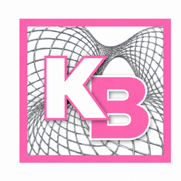

[English](README.md)

<picture>
  <source media="(prefers-color-scheme: dark)" srcset="assets/design/icons/dark/KiraBridge-dark-256.png">
  
</picture>

# KiraBridge

**Du redest mit der KI. Die Arbeit landet auf deinem Rechner.**

KiraBridge verbindet ChatGPT mit **Grok Build und Codex, die in Terminalfenstern
auf deinem Computer laufen**. Besprich im Chat, was du erledigen möchtest, gib die
Arbeit an diese Terminalagenten weiter und verfolge ihre Antworten — mit den von dir erlaubten Zugriffen.

**macOS · Intel — [0.8.0rc33](https://github.com/landjunge/KiraBridge/releases/tag/v0.8.0rc33) · 4. November 2026 · Vorabversion**

### [KiraBridge herunterladen — App und Installer](https://github.com/landjunge/KiraBridge/releases/download/v0.8.0rc33/KiraBridge-0.8.0rc33-Intel-Installer.zip)

[Prüfsummen](https://github.com/landjunge/KiraBridge/releases/download/v0.8.0rc33/SHA256SUMS)
· [Alle Versionen](https://github.com/landjunge/KiraBridge/releases)

Für die Downloads brauchst du ein GitHub-Konto mit Zugriff auf dieses private Repository.
Dies ist eine Vorabversion; eine stabile Version gibt es noch nicht. RC33 ist für Intel-Macs verfügbar.

Dieselbe Version enthält eine [Windows 11-Entwicklungsvorschau](https://github.com/landjunge/KiraBridge/releases/download/v0.8.0rc33/KiraBridge-0.8.0rc33-Windows-Dev-Kit.zip)
mit nativer Tastatur, Shortcuts und abgesicherter Fenstersteuerung. Es ist ein
separates Entwicklungspaket; allgemeine Windows-Datei-, Prozess- und Terminaltools
gehören nicht zu seinem Umfang. Siehe [RC33-Paketprüfung, Installationsstand und Grenzen](docs/RC33-DELIVERY-20261104.md).

Das [Offline-Windows-Setup.exe](https://github.com/landjunge/KiraBridge/releases/download/v0.8.0rc33/KiraBridge-0.8.0rc33-Windows-x64-Setup.exe) hat lokale Windows-11-Tests bestanden; siehe
[Build- und Abnahmestand](docs/WINDOWS-INSTALLER-RC33-20261104.md).

## Wobei KiraBridge dir hilft

- **An lokalen Projekten arbeiten:** Lass deine verbundene KI Projektdateien und
  Protokolle lesen, Dateien bearbeiten oder Befehle ausführen — im erlaubten Rahmen.
- **Mit Terminalagenten arbeiten:** Schicke Aufträge an Grok Build und Codex
  in ihren eingerichteten Terminalsitzungen auf deinem Computer.
- **Die Arbeit verfolgen:** Sieh Anfragen, Nachrichten und Ergebnisse im lokalen Steuerfenster.
- **Den Zugriff bestimmen:** Lege fest, welche Ordner und Aktionen erlaubt sind
  und wann ein Auftrag deine Freigabe braucht.

ThreadDesk und andere Integrationen sind optional. Der Kern von KiraBridge funktioniert eigenständig.

## Loslegen

1. **Installieren oder aktualisieren.** Lade das Intel-Installer-ZIP herunter und
   entpacke es vollständig. Öffne `KiraBridge-Installer.app` und folge der Bestätigung
   und sichtbaren Terminalinstallation. Verwende ein separates Terminalfenster;
   laufende Agentensitzungen erhalten.
2. **App öffnen.** Der Installer aktualisiert Dienst und Desktop-App gemeinsam.
   Öffne `KiraBridge.app` in `~/Applications`. Vorhandene Einstellungen und Zugänge
   bleiben erhalten; der Installer erstellt eine Rückfallsicherung.
3. **Chat verbinden.** Folge der [ChatGPT-Verbindungsanleitung](docs/CHATGPT.md).
   Bitte ihn zum Einstieg, eine kleine Datei aus einem erlaubten Ordner zu lesen.
   Gib die Anfrage bei Bedarf frei und prüfe das Ergebnis in deinem Chat.

**Voraussetzungen:** Intel-Mac, geprüft mit macOS 15.7.4; Python 3.11 und uv 0.11.6
bereits im Terminal verfügbar; Internet zum Laden von Abhängigkeiten.
Installiere mit deinem normalen Benutzerkonto. KI-Konten und mögliche Anbieterkosten
bleiben getrennt; die Chatverbindung braucht die passenden Kontoberechtigungen.
Für Terminalaufträge müssen Grok Build oder Codex installiert und angemeldet sein.
Richte ihre Terminalsitzung in KiraBridge als Ziel ein.

Diese Vorabversion hat bekannte Einschränkungen bei der Terminalbedienung; die App
ist nicht von Apple notarisiert. Der [RC33-Paketnachweis](docs/RC33-DELIVERY-20261104.md)
beschreibt das aktuelle Paket; [frühere Installation und Hilfe](docs/INSTALL-DE.md)
dokumentiert weiterhin RC20.

## Tastenfolgen und weniger Cloudaufrufe

`keyboard_sequence` führt bis zu 32 echte Key-down/Key-up-Paare ohne Zwischenablage
seriell in einem idempotenten Task aus. Wenn die nächste Taste von der Rückmeldung
der vorigen abhängt, bleiben einzelne Aufrufe erforderlich. Blocktext ist ein
eigener Vorgang und ersetzt keine verlangten einzelnen Tastenereignisse.

Bekannte Lesewerkzeuge teilen eine Übergabe über
`read_query(query={"operation":"tool.batch","calls":[...],"result_format":"structured"})`.
Das optionale strukturierte Format entfernt ausschließlich bewiesene äquivalente
JSON-Textkopien; alle strukturierten Werte, Fehler und Metadaten bleiben.
Der Default ist `full`. Rechte werden frisch geprüft. Bei ungewissem Ausgang
denselben Task lesen, statt die Eingabe erneut auszuführen.

[RC28-Tastenfolgen](docs/RC28-E2E-LATENCY-20261103.md) ·
[RC29-Aufrufreduktion](docs/RC29-CLOUD-CALL-REDUCTION-20261103.md) ·
[RC30-Messungen, Installation und Grenzen](docs/RC30-HOTPATHS-20261103.md).
Dieselben acht großen Leseergebnisse benötigten im gemessenen RC30-Vergleich einen
statt zwei Apps-Aufrufe; Median 22,72 → 13,02 Sekunden bei je drei Gruppen.
Cloudlatenz bleibt; das ist kein neuer physischer Tasten- oder Voicevergleich.

RC31 ergänzt direkte native JSON-Reads über `read_query` mit `operation="native.read"`
und begrenzte Accessibility-Unterbäume mit `max_depth>0`. Dadurch sinken wiederholte
UI-Leseaufrufe und persistente Taskdaten. Ereignisabrufe laden große Ausgaben nicht
mehr mit. Siehe [RC31-Umsetzung, Messungen und Auslieferungsstand](docs/RC31-NATIVE-READS-20261103.md).

RC32 bündelt zusätzlich Attribute innerhalb optionaler UI-Unterbäume. Dieselben
zwölf eigenen AppKit-Buttons benötigten im kontrollierten nativen Test 8,14 statt
16,86 ms Median bei zwanzig abwechselnden Runden. Siehe [RC32-Messungen und Grenzen](docs/RC32-NATIVE-ATTRIBUTE-BATCHING-20261103.md).

## Lizenz

Private, nicht geschäftliche Nutzung ist unter der
[Netzwerkpunkt Personal Use License 1.0](LICENSE) kostenlos. Geschäftliche Nutzung
benötigt eine gesonderte schriftliche Erlaubnis. Der deutsche Lizenztext ist maßgeblich.

[Entwicklerdokumentation](docs/DEVELOPERS.de.md)

[Frühere Windows-Vorschau dev2](https://github.com/landjunge/KiraBridge/releases/tag/windows-v0.8.0rc31.dev2):
Native Tastatur und lokales MCP haben die Abnahme in einer eigenen Windows 11-VM bestanden.
[Ergebnisse und Grenzen](docs/WINDOWS-DEVELOPMENT-20261103.md); macOS bleibt getrennt.

[Frühere Windows-Desktop-Vorschau dev3](https://github.com/landjunge/KiraBridge/releases/tag/windows-v0.8.0rc31.dev3): Alle sechs nativen
Gastprüfungen bestanden, einschließlich Ctrl-/Alt-/Shift-Kombinationen und
abgesicherter Fenstersteuerung. Veröffentlichte Downloads und die getrennte
Windows 11-Installation sind geprüft. [Belege und Grenzen](docs/WINDOWS-DESKTOP-20261104.md);
dev2 bleibt als Rückfallmöglichkeit erhalten.
