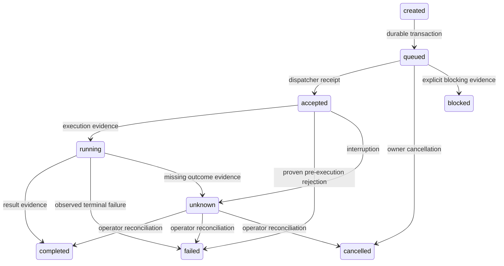

# Architektur

Aktueller Quellstand: unveröffentlichter RC17-Konsolidierungskandidat; [Zusammenführung](CONSOLIDATION-20261024.md). Produktive RC14 unverändert.

Historischer Nachweis vom 20. Oktober 2026: damals produktiv `0.8.0rc11`; gesicherter Ausgangspunkt `0.8.0rc3`, Quellpin
`4188f001d405a9f04ee63f6bbe1b088c6f39d26e`, Dokumentation `d9727ac1`,
portable Prüfergänzung `5680921`. Die schrittweise Weiterentwicklung und ihre
tatsächlichen Abnahmen stehen in [ARCHITECTURE-STAGES-20261020.md](ARCHITECTURE-STAGES-20261020.md).

## Abhängigkeiten und Verantwortung

MCP und CLI sind Eingänge in dieselbe `Bridge`. Sie reichen versionierte Anfragen an den Task Manager weiter. Erst dieser speichert und verteilt Aufträge an ausführende Manager. Die Protokollschicht führt weder Shell-Befehle aus noch erstellt sie Freigaben.

| Modul | Verantwortung |
|---|---|
| bridge_core | Konfiguration, typisierte Eingaben, Fehlercodes, Operationsregister, Orchestrierung |
| task_manager | SQLite-Schema v2, Queue, Empfangsbelege, Zustandsmaschine, Leases, Wiederherstellung |
| agent_manager | Identitäten, Adapterregister, Codex-JSONL, Grok-ACP/API und getrennte native CLI-Textadapter |
| mcp_gateway | Offizielles SDK, stdio/Streamable HTTP, ausgehende getrennte Client-Verbindungen |
| terminal_manager | Begrenzte Prozesssitzungen, Ausgaben, Zeitlimits, Prozessgruppen |
| session_manager | Bestehende Terminal.app-/tmux-Ziele, exakte Fenster-/TTY-/PID-Prüfung, Einfügen und separates Return |
| session_ports | Benannte Autorisierungs-, Freigabe-, Audit- und Transportpartner ohne gesamtes Bridge-Objekt (aktiv ab rc8) |
| visible_handoff | Verbindliche persistierte bestehende CLI-Ziele für alle Absender und Adapter; getrennte Transport-/Quittungs-/Antwortbelege, kein Hintergrundersatz |
| filesystem_manager | Pfadprüfung, descriptor-relative Operationen, begrenztes Lesen, atomisches Schreiben |
| clipboard_manager | Explizite Textübertragung, Byte-Limits, Rücklesebestätigung, kein Polling |
| process_manager | Übersicht eigener Sitzungen; kein Zugriff auf fremde Prozesse |
| security_manager | Capability-Prüfung und kryptografisch zufällige, einmalige Aufgabenfreigaben |
| platform_adapters | macOS/Linux, Prozessstart und Sperren; Windows-Erweiterungspunkt |
| audit_manager | Prüfung einer SHA-256-verknüpften Audit-Kette |
| output_history | Begrenzte neue rohe Terminalausgaben, autorisierte Auflösung und Taskresultatcodec; historische Audit-Ketten bleiben erhalten (aktiv ab rc9) |
| operator_queries | Lokale Status-/Protokollabfragen über fachliche Besitzer (aktiv ab rc8) |
| operator_application | Zentrale Verdrahtung der schmalen lokalen Anwendungspartner (aktiv ab rc8) |
| operator_control / operator_actions | Bedienlogik und atomare Aktionsreservierung; keine HTTP-Verantwortung (aktiv ab rc8) |
| operator_platform | Austauschbare Prozessbeobachtung/-aufrufe und authentifizierter lokaler MCP-Client (aktiv ab rc8) |
| operations_service | Dauerhafte Wartungssperre, geprüfte Konfigurationsaktivierung, Wiederherstellung |

Es gibt drei direkte Laufzeitabhängigkeiten: `mcp`, `httpx` und `uvicorn`. Pydantic wird durch das MCP SDK verwendet. `uv.lock` hält auch transitive Versionen fest. Python 3.11 ist die Untergrenze, damit ein Intel-Mac ohne GPU teilnehmen kann.

## Versionierte Grenzen

- Paketversion: `kirabridge.__version__`.
- Eigene Anfragen: `TaskRequest.api_version == "1"`; unbekannte Versionen werden abgelehnt.
- Operationsargumente: Pydantic mit `extra="forbid"` und strenger Typprüfung.
- Agenten: `AgentAdapter.interface_version == "1"`; `register(kind, adapter)` verbietet doppelte Namen und fremde Versionen.
- MCP-Protokoll: Das offizielle SDK übernimmt die Initialisierung und Versionsaushandlung. Die eigene API-Version ist davon unabhängig.
- Grok Build: ACP-Protokollversion 1; andere Initialisierungsantworten werden abgelehnt.
- Datenbank: `PRAGMA user_version=2`; Version 1 wird über die vorhandene Migration auf 2 angehoben. Zukünftige Schema-Versionen werden nicht still geöffnet. Weitere Migrationen benötigen einen ausdrücklichen Rückkehrplan; eine ältere Datenbankkopie darf keine inzwischen gespeicherten Aufträge ersetzen.

Eine neue Agentenart implementiert das `AgentAdapter`-Protokoll und wird in `bridge.agents.register(...)` registriert. `AgentConfig.kind` wählt den Adapter, der konfigurierte Name ist die auftragsgebundene Agentenidentität. Erweiterungen für Claude Code, Gemini CLI, OpenCode und A2A benötigen entsprechende eigene Protokollimplementierungen; vorhandene Prozesse sind kein Ersatz für diese Adapter.

## Zustände und Belege

`accepted` beweist den Empfang durch den KiraBridge-Dispatcher. Das ist keine Annahme durch den externen Provider. Ein Agentensitzungsbeleg wird separat als Ereignis gespeichert. Codex benötigt `thread.started`, einen Laufbeleg und `turn.completed` für Erfolg. Grok ACP benötigt die konkrete `sessionId` und den `stopReason`. Der Grok-API-Adapter benötigt eine feste Response-ID und einen Abschlussgrund. `running` bezeichnet einen zuletzt tatsächlich beobachteten Ausführungsbeginn; es ist keine zeitlose Behauptung über einen externen Prozess.

Ein Agententurn bestätigt ausschließlich diesen Turn. `project_completion_verified` bleibt ausdrücklich `false`.

## Dauerhaftigkeit und Parallelität

SQLite läuft mit WAL, `synchronous=FULL` und Fremdschlüsseln. Die Verbrauchsmarkierung einer Freigabe, Aufgabenanlage, Anfangsereignisse und Audit-Eintrag bilden eine Transaktion. `(principal, idempotency_key)` ist eindeutig; identische Wiederholungen lesen den bestehenden Auftrag, abweichende Inhalte werden abgelehnt. Aufgaben-IDs sind global eindeutig.

Ein exklusiver POSIX-Lock erlaubt nur einen Dispatcher pro Datenverzeichnis. Mehrere kurzlebige administrative Prozesse dürfen gleichzeitig Freigaben schreiben oder Status lesen. Nach Lock-Übernahme werden alte `accepted`/`running`-Aufträge `unknown`; nur noch nie beanspruchte `queued`-Aufträge laufen automatisch weiter. Abgelaufene Leases berechtigen niemals zum blinden Wiederholen. Heartbeats aktualisieren die Lease, ohne fortlaufend Audit-Ereignisse zu erzeugen.

Standardmäßig arbeiten zwei Ausführungs-Worker, zwei reservierte Lese-Worker und ein eigener Stopp-Worker. Die produktive Konfiguration wählt einen normalen Ausführungs-Worker. Prozessstopps und begrenzte Leseabfragen behalten damit eigene Kapazität. Im Leerlauf warten Worker auf ein Event; alle zwei Sekunden erfolgt ein Abgleich für Aufträge, die externe lokale CLI-Prozesse eingereiht haben.

Der aktivierte Etappe-4-Stand `0.8.0rc7` trennt zwei reservierte Lese-Worker
von einem eigenen Stopp-Worker. Terminalabfragen nutzen unabhängig vom
Clientweg `TerminalQueries`, `session.inspect`, dieselbe Freigabeentscheidung
und ein Budget von acht Sekunden. Die Operationsbeschreibungen enthalten
Capability, Wirkung und Ausführungsklasse und dienen Katalog, Vorprüfung und
Queue gemeinsam. `max_read_queued` begrenzt die neue Lesequeue. Details und
der jeweilige tatsächliche Abnahmestand stehen in der Etappenakte.

Die lokalen HTTP-Oberflächen ab rc8 kennen keine SQL-Tabellen,
kein vollständiges Bridge-Objekt und keine Prozessstart-APIs. Der Anwendungskern
nutzt Besitzerabfragen, den bestehenden Betriebsdienst und getrennte Plattform-
und MCP-Ports. Konsolenaktionen werden vor Ausführung atomar reserviert; auch
getrennte Steuerfenster-Prozesse starten dieselbe Kennung nur einmal. Unklare
Ausgänge bleiben unklar und werden nicht automatisch wiederholt. Diese interne
Entkopplung ist keine Sandbox gegen freie OS-Rechte des Mac-Benutzers.

Ab rc8 koordiniert `SessionManager` Autorisierung und exakte
Auswahl über `SessionPorts`. `platform_adapters.terminal_app` und
`platform_adapters.tmux` kapseln die bisher nachgewiesenen Plattformbefehle.
Adapter können ohne vollständigen Kern ersetzt werden. Ein unklarer Eingabeausgang
führt zu keiner automatischen Wiederholung und zu keinem anderen Transport.
Die sichtbare zentrale Übergabe behält ihre persistierte Zielbindung für alle
Absender einschließlich Grok und für Rückantworten.

Die Aktivierungsabfragen ab rc8 werden ebenfalls von den
jeweiligen Fachbesitzern ausgeführt. `OperationsService` erhält nur die gemeinsame
Abfragefunktion und übergibt den eigenen Transaktionskontext. Insbesondere gilt
die Ergebnisverarbeitung eines Teamauftrags als laufende Arbeit; vor ihrem Abschluss
wird kein Neustart ausgelöst. Die Etappenakte trennt Umsetzung, Grok-Prüfung,
Quellpin, Aktivierung und tatsächliche praktische Nachweise.

Die aktivierte Version `0.8.0rc4` ergänzt die persistenten Zustände sichtbarer Übergaben
und einmaliger Fensterstarts additiv in Schema 2. Neue CLI-Übergaben müssen
die gespeicherte bestehende Fenster-/TTY-/Sitzungs-PID-/Agenten-PID-Bindung
verwenden. Neue Fenster benötigen einen genauen Auftrag des lokalen Bedienwegs;
kein Agenten-bool und kein Fehlerpfad darf ihn ersetzen. Ein unklarer Ausgang
wird nicht erneut ausgeführt. Die zusätzliche Voice-Tokenpflicht ist auf Daniels
ausdrückliche Anweisung entfernt; vorhandene Alt-Puffer werden nicht automatisch
versandt. Quelländerung, Aktivierung und praktische Abnahme werden in der
Etappenakte getrennt geführt.

MCP-HTTP ist zustandslos auf Transportebene. Identität wird für jeden HTTP-Aufruf erneut aus dem authentifizierten Kontext bestimmt. Aufgaben und Ergebnisse bleiben persistent. Eine abgebrochene Client-Verbindung bricht einen gespeicherten Auftrag nicht automatisch ab. Ausgehende MCP-Verbindungen haben jeweils eine eigene Besitzer-Coroutine, damit die Lebensdauer der anyio-Kontexte korrekt bleibt.

## Ressourcen

Standardwerte: 1000 wartende Ausführungsaufträge plus 32 reservierte Prozesssteuerungsaufträge, 2 MiB Anfrage, maximal 1 MiB rohe Terminalausgabe, maximal 1 MiB Clipboard-/Dateiinhalt, 1000 Verzeichniseinträge oder Ereignisse pro Seite, 32 parallele HTTP-Anfragen, 8 ausgehende MCP-Verbindungen, 32 gleichzeitige ausgehende Toolaufrufe. Auch eine volle Ausführungsqueue blockiert damit die Prozesssteuerung nicht. Die Anzahl historischer Aufgaben und Audit-Einträge wächst mit der Nutzung; Archivierung erfolgt bewusst administrativ und nicht durch unbeaufsichtigte Löschung.

## Verbindliche Freigabeentscheidung (Etappe 2, 0.8.0rc5)

`permissions.decision` liefert Capability-Ergebnis, Sammelstufe, dauerhafte
Operationsausnahme, optionalen Terminalpuffer, Grund und Revision. Queue,
Ausführungsgrenze, Terminalanzeige und Operationskatalog verwenden sie.
`config_revision` ist der beim Laden erfasste effektive Konfigurationshash;
`permission_revision` umfasst die aktuell ausgewerteten Freigabefelder ohne
generische Konfigurationsausgabe. Der historische grobe `approval_required`-
Schalter bleibt für alte Clients erhalten; für eine konkrete Operation sind
`permission_decision` und `terminal_access.input_decision` maßgeblich.

Eine fehlende Capability bleibt auch mit einer dauerhaften Ausnahme gesperrt.
Die Oberfläche zeigt Ausnahmen ausdrücklich auch bei „Nur mit Erlaubnis“.
Der authentifizierte lokale Widerruf entfernt nur die bezeichnete Ausnahme.
Weder Reparatur noch erneute Wahl von „Voll erlaubt“ fügt sie wieder hinzu;
die aktuelle Sammelstufe wirkt unabhängig davon weiter. Vorhandene Kira-/Eve-
Ausnahmen bleiben bei der Aktualisierung erhalten. Alte Voice-Puffer werden
nicht freigegeben und die aufgehobene zusätzliche Voice-Tokenpflicht bleibt aus.

## Koordinierte Aktivierung (Etappe 3, 0.8.0rc6)

`OperationsService` besitzt Konfigurationsgenerierung, private Konfigurations-
snapshots, Wartung, Supervisoraufruf und Prüfung des geladenen Stands. Die
Bedienrouten reichen ihre authentifizierten Aktionen weiter. `activation_runs`
und die Aufgaben-/Nachrichten-/Team-Claims teilen dieselbe SQLite-Sperrgrenze.
Neue Arbeit wird während der Aktivierung zurückgewiesen; bereits gespeicherte
Arbeit darf in draining fertigwerden. Nur exakt versiegelte, bereits reservierte
Teamfortsetzungen und bestehende Ausführungen können unter dieser Sperre
fortfahren. Prozessstopps behalten in draining ihre Kapazität.

Nach dem Leerlauf sperrt verifying auch Claims. Supervisor- und Netzwerkaufrufe
laufen außerhalb schreibender Transaktionen. Erst eine neue Instanz mit passender
Version, Quelle, Datei- und effektiver Konfigurationsrevision schließt die
Aktivierung ab. Fehler bleiben als failed_blocked sichtbar, bis der lokale
Doktor die passende vorherige Konfiguration mit aktuellem kompatiblem Code
wiederhergestellt und tatsächlich geprüft hat. Datenbanken werden nie aus einer
alten Sicherung darüberkopiert; Schemawechsel benötigen einen eigenen Plan.
Ein noch lebender Controller wird nicht durch einen zweiten ersetzt.

Abgeschlossene Modellturns können ihre dauerhaften Team-Ergebnisaktionen nach
Aktivierung unter denselben Aktionskennungen fortsetzen; der Modellturn läuft
nicht erneut. Voller lokaler OS-Zugriff ist weiterhin keine Bridge-Sandbox.

Der ältere Grok-Clientweg `session.input` liefert nun auch eine tatsächlich
zentral bestätigte Agentenantwort als fertiges `conversation_return`. Dafür
müssen Auftrags-ID, completed-Beleg, Fenster/PID, Antwort-ID und authentifizierter
Principal/Scope zusammenpassen. Transporterfolg oder behauptete bool-Felder
genügen nicht. Audioausgabe wird weiterhin nicht als serverseitig beobachtet
ausgegeben.

## Begrenzte neue Terminalausgaben (Etappe 6, aktiviert ab rc9)

`OutputHistory` besitzt die additive Tabelle `output_snapshots` und den internen
Task-Resultatcodec. Neue rohe Mitschnitte/stdout/stderr stehen dort, Taskresultate
und Audit enthalten Referenzen und Metadaten. Die bestehenden öffentlichen
Resultatfelder werden erst beim autorisierten Lesen aufgelöst. Ein abgelaufener
Snapshot ändert keinen Auftragszustand und löst keine Ausführung aus.
Taskzustand, Snapshot, Audit und dauerhafte Abschlussmeldung teilen weiterhin
eine Transaktion. Alte Daten und die historische Audit-Kette bleiben unverändert.
Die Standardgrenzen sind 16 MiB Nutzlast, 256 Einträge, 8 MiB je Eintrag und
sieben Tage; fachliche Antworten und historische Rohdaten zählen nicht dazu.
Ein Hash belegt Bytes, nicht Identität oder Ausführung. Rückkehrplan und
tatsächlicher Abnahmestand: [Etappenbericht](ARCHITECTURE-STAGES-20261020.md).

## Sichtbare Übergaben bei belegtem Ziel (rc10)

Der Nachrichtenreceiver prüft die zentrale sichtbare Route vor dem Claim.
Beschäftigte oder gesperrte Ziele lassen ungeclaimte Nachrichten mit verständlichem
Grund in der dauerhaften Queue. Andere freie Ziele behalten ihre Kapazität.
Historische unbekannte Eingaben werden ausschließlich über tatsächliche
Empfangs-/Antwortbelege abgeglichen. Unklare Ergebnisse werden nie blind
wiederholt. [Reparatur und Abnahmegrenzen](VISIBLE-HANDOFF-RECOVERY-20261020.md).

Ab rc11 wird Codex-Bereitschaft aus aktuellem Eingabefeld und ausdrücklich
lokal gebundenem typisiertem Turnprotokoll ermittelt. Historische oder zitierte
Arbeitswörter sind allein kein Arbeitsnachweis. Tatsächliche Arbeit oberhalb
des Prompts, nicht leere Eingabe, Scrollansicht, unbekannter Zustand und
Zielabweichung bleiben getrennte Sperrgründe. Ein Protokollfingerprint beweist
keine Identität und keine Isolation gegen denselben OS-Benutzer.
Die letzte Bereitschaftsprüfung liegt vor dem ersten Eingabeversuch. Nur ein
belegter `preinput_abort` erlaubt sicheres Warten; mögliche Eingabe/Return
bleibt unbekannt und wird nicht wiederholt. Ein konkret durch ursprünglichen
Quellstand und Ereignisse bewiesener früherer Vor-Eingabe-Abbruch kann separat
lokal abgeglichen werden; das ist keine allgemeine Unknown-Freigabe.

## RC16 opt-in modules / optionale Module

See [modularity review](MODULARITY-REVIEW-20261024.md), [file transfer](FILE-TRANSFER.md),
[receiver contract](THREADDESK-FILE-TRANSFER-V1.md) and [discovery/terminal](DISCOVERY-VISIBLE-TERMINAL.md).
These candidate additions do not grant production access or establish receiver acceptance.
