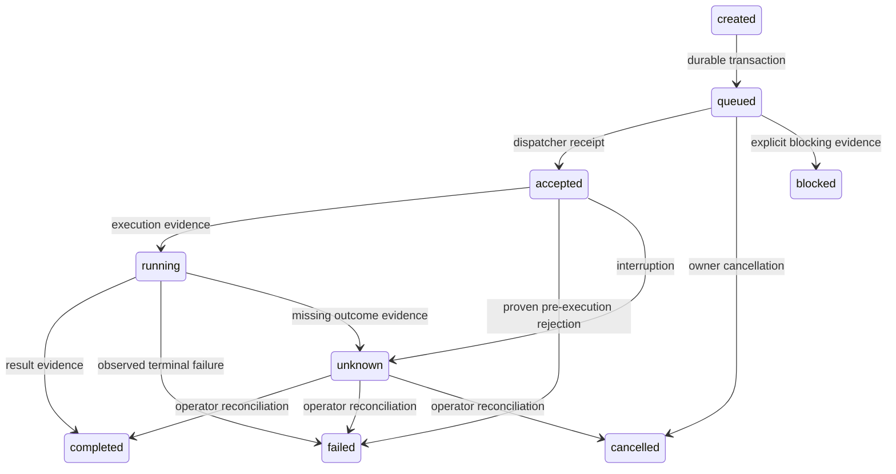

# Architektur

Stand 20. Oktober 2026: produktiver Ausgangspunkt `0.8.0rc3`, Quellpin
`4188f001d405a9f04ee63f6bbe1b088c6f39d26e`, Dokumentation `d9727ac1`,
portable Prüfergänzung `5680921`. Die schrittweise Weiterentwicklung und ihre
tatsächlichen Abnahmen stehen in [ARCHITECTURE-STAGES-20261020.md](ARCHITECTURE-STAGES-20261020.md).

## Abhängigkeiten und Verantwortung

MCP und CLI sind Eingänge in dieselbe `Bridge`. Sie reichen versionierte Anfragen an den Task Manager weiter. Erst dieser speichert und verteilt Aufträge an ausführende Manager. Die Protokollschicht führt weder Shell-Befehle aus noch erstellt sie Freigaben.

| Modul | Verantwortung |
|---|---|
| bridge_core | Konfiguration, typisierte Eingaben, Fehlercodes, Operationsregister, Orchestrierung |
| task_manager | SQLite-Schema v2, Queue, Empfangsbelege, Zustandsmaschine, Leases, Wiederherstellung |
| agent_manager | Identitäten, Adapterregister, Codex-JSONL, Grok-ACP und Grok-API |
| mcp_gateway | Offizielles SDK, stdio/Streamable HTTP, ausgehende getrennte Client-Verbindungen |
| terminal_manager | Begrenzte Prozesssitzungen, Ausgaben, Zeitlimits, Prozessgruppen |
| session_manager | Bestehende Terminal.app-/tmux-Ziele, exakte Fenster-/TTY-/PID-Prüfung, Einfügen und separates Return |
| visible_handoff | Verbindliche persistierte bestehende CLI-Ziele für alle Absender und Adapter; getrennte Transport-/Quittungs-/Antwortbelege, kein Hintergrundersatz |
| filesystem_manager | Pfadprüfung, descriptor-relative Operationen, begrenztes Lesen, atomisches Schreiben |
| clipboard_manager | Explizite Textübertragung, Byte-Limits, Rücklesebestätigung, kein Polling |
| process_manager | Übersicht eigener Sitzungen; kein Zugriff auf fremde Prozesse |
| security_manager | Capability-Prüfung und kryptografisch zufällige, einmalige Aufgabenfreigaben |
| platform_adapters | macOS/Linux, Prozessstart und Sperren; Windows-Erweiterungspunkt |
| audit_manager | Prüfung einer SHA-256-verknüpften Audit-Kette |

Es gibt drei direkte Laufzeitabhängigkeiten: `mcp`, `httpx` und `uvicorn`. Pydantic wird durch das MCP SDK verwendet. `uv.lock` hält auch transitive Versionen fest. Python 3.11 ist die Untergrenze, damit ein Intel-Mac ohne GPU teilnehmen kann.

## Versionierte Grenzen

- Paketversion: `kirabridge.__version__`.
- Eigene Anfragen: `TaskRequest.api_version == "1"`; unbekannte Versionen werden abgelehnt.
- Operationsargumente: Pydantic mit `extra="forbid"` und strenger Typprüfung.
- Agenten: `AgentAdapter.interface_version == "1"`; `register(kind, adapter)` verbietet doppelte Namen und fremde Versionen.
- MCP-Protokoll: Das offizielle SDK übernimmt die Initialisierung und Versionsaushandlung. Die eigene API-Version ist davon unabhängig.
- Grok Build: ACP-Protokollversion 1; andere Initialisierungsantworten werden abgelehnt.
- Datenbank: `PRAGMA user_version=2`; Version 1 wird über die vorhandene Migration auf 2 angehoben. Zukünftige Schema-Versionen werden nicht still geöffnet. Weitere Migrationen benötigen einen ausdrücklichen Rückkehrplan; eine ältere Datenbankkopie darf keine inzwischen gespeicherten Aufträge ersetzen.

Eine neue Agentenart implementiert das `AgentAdapter`-Protokoll und wird in `bridge.agents.register(...)` registriert. `AgentConfig.kind` wählt den Adapter, der konfigurierte Name ist die auftragsgebundene Agentenidentität. Erweiterungen für Claude Code, Gemini CLI, OpenCode und A2A benötigen entsprechende eigene Protokollimplementierungen; vorhandene Prozesse sind kein Ersatz für diese Adapter.

## Zustände und Belege

`accepted` beweist den Empfang durch den KiraBridge-Dispatcher. Das ist keine Annahme durch den externen Provider. Ein Agentensitzungsbeleg wird separat als Ereignis gespeichert. Codex benötigt `thread.started`, einen Laufbeleg und `turn.completed` für Erfolg. Grok ACP benötigt die konkrete `sessionId` und den `stopReason`. Der Grok-API-Adapter benötigt eine feste Response-ID und einen Abschlussgrund. `running` bezeichnet einen zuletzt tatsächlich beobachteten Ausführungsbeginn; es ist keine zeitlose Behauptung über einen externen Prozess.

Ein Agententurn bestätigt ausschließlich diesen Turn. `project_completion_verified` bleibt ausdrücklich `false`.

## Dauerhaftigkeit und Parallelität

SQLite läuft mit WAL, `synchronous=FULL` und Fremdschlüsseln. Die Verbrauchsmarkierung einer Freigabe, Aufgabenanlage, Anfangsereignisse und Audit-Eintrag bilden eine Transaktion. `(principal, idempotency_key)` ist eindeutig; identische Wiederholungen lesen den bestehenden Auftrag, abweichende Inhalte werden abgelehnt. Aufgaben-IDs sind global eindeutig.

Ein exklusiver POSIX-Lock erlaubt nur einen Dispatcher pro Datenverzeichnis. Mehrere kurzlebige administrative Prozesse dürfen gleichzeitig Freigaben schreiben oder Status lesen. Nach Lock-Übernahme werden alte `accepted`/`running`-Aufträge `unknown`; nur noch nie beanspruchte `queued`-Aufträge laufen automatisch weiter. Abgelaufene Leases berechtigen niemals zum blinden Wiederholen. Heartbeats aktualisieren die Lease, ohne fortlaufend Audit-Ereignisse zu erzeugen.

Standardmäßig arbeiten zwei Ausführungs-Worker und ein reservierter Prozesssteuerungs-Worker. So bleibt das Beenden eines eigenen Prozesses auch bei ausgelasteten Ausführungsslots erreichbar. Im Leerlauf warten Worker auf ein Event; alle zwei Sekunden erfolgt ein Abgleich für Aufträge, die externe lokale CLI-Prozesse eingereiht haben.

Der Kandidat `0.8.0rc4` ergänzt die persistenten Zustände sichtbarer Übergaben
und einmaliger Fensterstarts additiv in Schema 2. Neue CLI-Übergaben müssen
die gespeicherte bestehende Fenster-/TTY-/Sitzungs-PID-/Agenten-PID-Bindung
verwenden. Neue Fenster benötigen einen genauen Auftrag des lokalen Bedienwegs;
kein Agenten-bool und kein Fehlerpfad darf ihn ersetzen. Ein unklarer Ausgang
wird nicht erneut ausgeführt. Die zusätzliche Voice-Tokenpflicht ist auf Daniels
ausdrückliche Anweisung entfernt; vorhandene Alt-Puffer werden nicht automatisch
versandt. Quelländerung, Aktivierung und praktische Abnahme werden in der
Etappenakte getrennt geführt.

MCP-HTTP ist zustandslos auf Transportebene. Identität wird für jeden HTTP-Aufruf erneut aus dem authentifizierten Kontext bestimmt. Aufgaben und Ergebnisse bleiben persistent. Eine abgebrochene Client-Verbindung bricht einen gespeicherten Auftrag nicht automatisch ab. Ausgehende MCP-Verbindungen haben jeweils eine eigene Besitzer-Coroutine, damit die Lebensdauer der anyio-Kontexte korrekt bleibt.

## Ressourcen

Standardwerte: 1000 wartende Ausführungsaufträge plus 32 reservierte Prozesssteuerungsaufträge, 2 MiB Anfrage, maximal 1 MiB rohe Terminalausgabe, maximal 1 MiB Clipboard-/Dateiinhalt, 1000 Verzeichniseinträge oder Ereignisse pro Seite, 32 parallele HTTP-Anfragen, 8 ausgehende MCP-Verbindungen, 32 gleichzeitige ausgehende Toolaufrufe. Auch eine volle Ausführungsqueue blockiert damit die Prozesssteuerung nicht. Die Anzahl historischer Aufgaben und Audit-Einträge wächst mit der Nutzung; Archivierung erfolgt bewusst administrativ und nicht durch unbeaufsichtigte Löschung.

