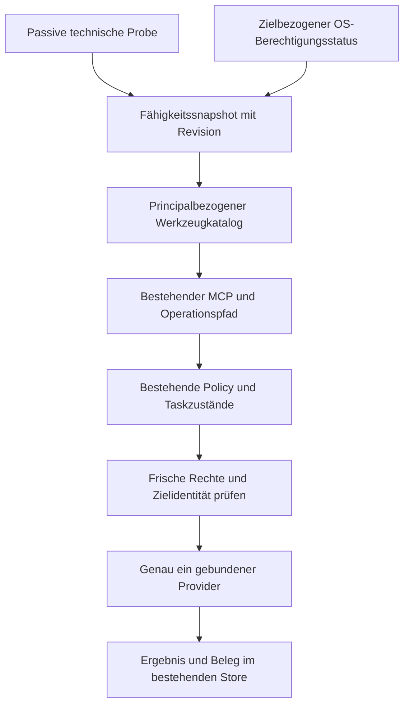

# macOS-Adapter: Bestandsaufnahme, Apple-Recherche und Architekturvorlage

Revision 1 · 31.10.2026 · **Entwurf zur Freigabe; keine Implementierungsfreigabe**.
Maschinenlesbarer Ausgangs-/Prüfbeleg:
[macos-adapter-phases1-3-20261031.json](evidence/macos-adapter-phases1-3-20261031.json).
Arbeitsboard: ThreadDesk `0ab8b95a7369`, Entwicklungsplan Revision 3,
gelesen über `get_thread`. `whiteboard_read` lieferte eine leere Eintragsliste;
der Plan steht in den Thread-Notizen. Der aktuelle Nutzerauftrag begrenzt die
Arbeit auf Phasen 1–3. Abweichende ältere AGENTS-/Releasevorgaben treten zurück.

## Umfang und Beleggrenzen

Kira-Skill `/Users/landjunge/.codex/skills/kira/SKILL.md` gelesen und angewendet.
Vorhandene Architektur, Installations- und Return-Abnahmeberichte wiederverwendet;
die abgeschlossene Return-Reparatur wurde weder wiederholt noch verändert.
Unabhängige native Rechercherolle `apple_research`, Integration und Prüfung durch
Root. Nur Dokumentation in einem eigenen Worktree; kein Push, Build, Install,
Neustart, Fensterwechsel oder Eingriff in laufende Sitzungen.

Die beiden Planquellen `KiraBridge_macOS_Integration_Arbeitsplan_2026-10-31.md`
und `KiraBridge_ThreadDesk_Whiteboard_Fortsetzung_2026-10-31.md` sind nicht
verfügbar: `library_search` im Arbeitsboard und im Koordinationsboard meldete
`index.status=missing`, `documents=0`. Im zusätzlich lesend geprüften lokalen
Libraryindex sind beide Titel und die Desktop-Commander-Recherche nicht enthalten.
Kein Index wurde neu aufgebaut, kein früherer Bibliotheksauftrag erneut gestartet.
**Der vom Plan verlangte Vergleich mit der ursprünglichen Desktop-Commander-
Recherche bleibt offen. Phase 1 ist deshalb insoweit nicht vollständig belegt.**
Die nachfolgende Lückenanalyse stammt aus dem vorhandenen Code, nicht aus
vermuteten Eigenschaften von Desktop Commander.

Gelesene bestehende Quellen: `ARCHITECTURE.md`, `DEVELOPMENT_PLAN.md`,
`RC20-RETURN-20261031.md`, `discovery.py`, `permissions.py`, `readiness.py`,
`terminal_access.py`, `bridge_core/bridge.py`, `mcp_gateway/server.py` sowie
die unten genannten Adapter und Tests. Ergänzend lokale Libraryquelle
`KiraBridge-Brainstorm-konsolidiert.md`, Record `23b3ce68e3f5`, SHA256
`3725f85ecc89fa36dbdf6daff4ba5c1d0225f88d30a91ba630255be4b07013de`:
Providervertrag und Trennung Verfügbarkeit/Berechtigung sind bereits geplant.
Koordinationsboard `188ce4729a62` nur gelesen, nicht beschrieben.

## Phase 1: tatsächlicher Ausgangsstand

| Gegenstand | Beobachtung am 31.10.2026 |
| --- | --- |
| Mac | `iMac17,1`, x86_64, 32 GiB RAM; macOS 15.7.4, Build 24G517 (`sysctl`, `sw_vers`) |
| Hauptcheckout | `/Users/landjunge/KiraBridge`, Branch `fix/visible-busy-idle-20261021`, HEAD `dfbae4802fb0b15975581b045f7129e10b69c8d6`; fremde Änderungen an README/cli/image_manager und viele untracked Dateien; unverändert erhalten |
| Remote | `git ls-remote origin refs/heads/main`: `307004e5b2e4285c19e8d7544bedf45b28297a0b`; kein Fetch/Push; Remote ist nicht identisch mit der lokalen Reparaturlinie |
| Analysebasis | sauberer Reparaturworktree HEAD `2a081b9` (nur Abschlussdokumentation nach Code `ecb76cb2082a863d5dfdcba3aef848a0ee0c9f33`); neuer Dokumentationsbranch `docs/macos-adapter-phases1-3-20261031` darauf |
| Installation | `~/.local/share/kirabridge/install/releases/0.8.0rc20-ecb76cb2082a`; current.json und launchd-Definition bestätigen diese Quelle |
| Core live | PID 15207, Start `2026-10-31T11:25:14.230578+00:00`, Instanz `938c88dce527450eaed07deddd1eaade`, Version 0.8.0rc20; authentifizierte `bridge_health(observe_terminals=false)`, Dispatcher aktiv |
| Codeidentität | Startup-Quellhash `878e18a5970fc601a74bb67b32a6536151391d840e273d4335fc2d2d25cb6eb1`; 124 Pythondateien auf Disk neu gehasht, gleicher Hash und bytegleich zur Analysebasis. Startup-Angabe ist keine Remote-Attestation |
| Weitere Dienste | approvals PID 15308 seit 12:26:21 CET; Tunnel PID 44533 seit 29.10. 02:28:53 CET. launchctl list bestätigt Core/approvals/Tunnel. Vorhandene Plistdateien allein beweisen keinen geladenen Dienst |
| Desktop-App | PID 47104 seit 30.10. 20:56:21 CET; Info.plist nennt Code `da1bdae`, rc20 und Mindestversion 12.0. App und Core haben unterschiedliche Codeidentitäten; keine neue App-Abnahme behauptet |
| Rollbackreferenz | vorhandene Installertransaktion `~/.local/share/kirabridge/install/backups/20261031-122507-d482dbad`; privater Reparaturbericht unter `~/.local/share/kirabridge/backups/rc20-return-key-20261031-01/`; diesmal kein Rollback ausgeführt oder neu validiert |

Live-Health meldet außerdem `diagnostics_storage.recording=budget_exhausted`:
Auditbelege sind nicht als unbegrenzt verfügbar anzunehmen. Keine Bereinigung
oder Konfigurationsänderung vorgenommen. Terminalberechtigungen der Bridge sind
keine OS-TCC-Freigabe; aktuelle AX-/Apple-Event-Rechte wurden nicht mit Dialogen
oder UI-Leseproben getestet.

### Inventar und Überschneidungen

| Funktion / vorhandener Pfad | Vorhandener Schutz / Grenze | Folgerung |
| --- | --- | --- |
| `bridge_core/bridge.py`: INPUTS, Composition Root, zentrale Fachmanager; Task-/Securitymanager | typisierte Eingaben, Principal, persistente Auftragszustände, Approval/Idempotenz | Adapter unter diesen Pfad hängen; keine zweite Queue oder Autorisierungsinstanz |
| `filesystem_manager/__init__.py`: read/list/write/mkdir/delete/move, PathScope | erlaubte Roots, ausgeschlossene Pfade, descriptor-/no-follow-Zugriff; Tests `test_desktop.py` | bestehenden portablen Dateikern behalten; macOS-Bookmarks optional ergänzen, Rechte nicht erweitern |
| `terminal_manager`, `process_manager`, `platform_adapters/__init__.py` | argv, kontrollierte Umgebung/CWD, begrenzte Ausgabe, eigene Prozessgruppen, Reaping; ProcessManager ist kein globaler Prozessmanager | native Appinventur wäre getrennte Lesefähigkeit; keine beliebige PID-Beendigung |
| `session_manager.py`, `session_ports.py`, `visible_handoff.py`, `literal_session_input.py`, `session_return.py` | frische Fenster-/TTY-/Shell-/Agentidentität, Busy-/Fokus-/Draftprüfung; Unknown bleibt ohne Replay | Domänenlogik erhalten; Migration darf keine zweite Eingaberoute eröffnen |
| `platform_adapters/terminal_app.py`: TerminalAppTransport | JXA über osascript-stdin, Terminal/System Events; Zeit-/Ausgabelimits, gezielte Fehler, ausgewählte AX-Aktion; `available` prüft derzeit nur darwin | technische Plattformprüfung ist noch kein Fähigkeits-/TCC-Modell |
| `platform_adapters/desktop.py`: MacDesktop | ioreg/IOConsoleUsers, Benutzer-/Lock-/OnConsole-Auswertung, unknown bei Ausfall; kein Freigabenachweis | undokumentierte Dictionarykeys als Kompatibilitätsheuristik isolieren; unknown nicht zu positiver Interaktionsfreigabe aufwerten |
| `clipboard_manager` + `MacOSAdapter.clipboard_command` | pbcopy/pbpaste für Text; eigener gemeinsamer Lock | Clipboardtext und Native-Paste nutzen unterschiedliche technische Blätter, aber dieselbe Ownership-Grenze |
| `platform_adapters/clipboard_lease.py` | NSPasteboard über JXA, Formate nur RAM, changeCount, begrenzter Helper, Restore nach Workerende; Nutzeränderungen erhalten | Blattadapter erhalten; Generation/Restore-Ergebnis Bestandteil des neuen Vertrags |
| `discovery.py`, `terminal_access.py`, `permissions.py`, `readiness.py` | Principal-/Configrevision, gecachte vs frische Beobachtung, Preflight getrennt von Freigabe | ausbauen statt duplizieren: OS-/Provider-/TCC-Kontext als eigene Revision ergänzen |
| `mcp_gateway/server.py:current_tools`, `threaddesk_dynamic.py`, `operations.py` | list_tools versieht Katalog mit Discovery-Metadaten ohne Terminalprobe; TD hat eigenen dynamischen Katalog | macOS-Registrierung muss alle direkten und generischen Aufrufwege abdecken; Toollistenänderung allein erzwingt keine Autorisierung |
| Notifications / allgemeine Systemeinstellungen / beliebige Appfenster | kein entsprechender allgemeiner macOS-Fachprovider im geprüften Kern belegt | optionale neue Fähigkeiten planen, nicht als vorhanden registrieren |

Repräsentative Werkzeugverträge: `file.read`/`ReadInput`,
`clipboard.read`/`ClipboardRead`, `process.list`/`EmptyInput`,
`session.catalog`/`EmptyInput`, `session.input`/`SessionInput`,
`terminal.visible`/`VisibleTerminalInput`; zentrale Zuordnung in INPUTS.
Schema, Operation-ID, Principal und Fachzuständigkeit bleiben maßgeblich.

### Tatsächlich ausgeführte Prüfung

Mit bestehender Entwicklungsvenv, `PYTHONDONTWRITEBYTECODE=1`, PYTHONPATH auf
dieser Quelle und `-p no:cacheprovider` ausgeführt: `tests/test_platforms.py`
sowie drei reine Auswertungstests aus `tests/test_mac_desktop.py`
(`console_state_uses_matching_user_and_actual_lock_flag`,
`another_users_active_desktop_does_not_confirm_our_session`,
`absent_or_unrecognized_console_data_is_unknown`, jeweils mit `test_`-Präfix).
**12 passed in 0.05s**. Diese Fälle rufen keine native UI/Clipboard/Sitzung auf.
Keine E2E-, Return-, Neuinstallations- oder neue macOS-TCC-Abnahme.
Weitere vorhandene Schutztests wurden gelesen, nicht erneut als bestanden gezählt:
`test_clipboard_lease.py`, `test_terminal_clipboard_integration.py`,
`test_discovery_visible.py`, `test_desktop.py`.

## Phase 2: öffentliche Apple-APIs

Alle Links am 31.10.2026 recherchiert. API-Verfügbarkeit und konkrete Erlaubnis
sind getrennte Größen; auch ein erlaubter Aufruf kann am Ziel scheitern.

| Bereich | Öffentliche Grundlage | Version / Berechtigungs- und Funktionsgrenze |
| --- | --- | --- |
| Dateien | [FileManager](https://developer.apple.com/documentation/foundation/filemanager), [Sandbox-Dateizugriff](https://developer.apple.com/documentation/security/accessing-files-from-the-macos-app-sandbox) | POSIX/ACL/TCC/Sandbox getrennt; Bookmarks nur im passenden Sandboxkontext. Kein universeller FDA-Check oder selbst erteiltes FDA-Recht |
| Prozesse und Apps | [Process](https://developer.apple.com/documentation/foundation/process), [runningApplications](https://developer.apple.com/documentation/appkit/nsworkspace/runningapplications), [NSRunningApplication](https://developer.apple.com/documentation/appkit/nsrunningapplication) | eigene Kinder vs GUI-Appinventur unterscheiden; PID/Startidentität und GUI-Runloop beachten; kein Ersatz für vollständigen Prozesskatalog |
| Fenster | [CGWindowListCopyWindowInfo](https://developer.apple.com/documentation/coregraphics/cgwindowlistcopywindowinfo(_:_:)), [SCShareableContent](https://developer.apple.com/documentation/screencapturekit/scshareablecontent) | Metadaten, Capture und Manipulation getrennt; ScreenCaptureKit-Familie ab 12.3, einzelne Symbole später; GUI-Sitzung und Screen-Recording-Rechte relevant |
| Accessibility | [AXUIElement](https://developer.apple.com/documentation/applicationservices/axuielement), [AXIsProcessTrustedWithOptions](https://developer.apple.com/documentation/applicationservices/1459186-axisprocesstrustedwithoptions) | Discovery mit Prompt=false; Attribute/Aktionen je Ziel prüfen. Rechteerfordernis hängt am aufrufenden Prozess, nicht nur am Bridgeprincipal |
| Apple Events | [AEDeterminePermissionToAutomateTarget](https://developer.apple.com/documentation/coreservices/3025784-aedeterminepermissiontoautomatet), [WWDC19](https://developer.apple.com/videos/play/wwdc2019/701/) | pro Ziel/Eventklasse, askUserIfNeeded=false; Ziel nicht zur Probe starten. Usage Description/Signatur/Entitlements bei paketierter nativer Ausführung separat prüfen |
| Clipboard | [NSPasteboard](https://developer.apple.com/documentation/appkit/nspasteboard), [AccessBehavior](https://developer.apple.com/documentation/appkit/nspasteboard/accessbehavior-swift.enum), [AppKit Updates](https://developer.apple.com/documentation/updates/appkit) | neue Symbole über SDK-/Runtime-Availability erkennen; exaktes Einführungssystem der neuen AccessBehavior-/detect-Symbole noch offen. Keine Inhaltsleseprobe; kein pauschales „Tahoe promptet immer“ |
| Benachrichtigungen | [UNUserNotificationCenter](https://developer.apple.com/documentation/usernotifications/unusernotificationcenter) | getNotificationSettings getrennt von requestAuthorization; eigene App, separate Alert/Sound/Badge-Settings; Versand ist keine sichere Zustellquittung |
| Einstellungen und Dienste | [CFPreferences](https://developer.apple.com/documentation/corefoundation/preferences-utilities), [SMAppService](https://developer.apple.com/documentation/servicemanagement/smappservice) | dokumentierte eigene Präferenzen; SMAppService ab 13 für gebündelte Dienste. Keine universelle System-Settings-Schreibschnittstelle; heutige launchd-Installation nicht nebenbei migrieren |
| Capture-Berechtigung | [CGPreflightScreenCaptureAccess](https://developer.apple.com/documentation/coregraphics/cgpreflightscreencaptureaccess()) | Preflight und Request getrennt; keine Rechteanforderung in tools/list. Ein negativer/unklarer Check darf keinen alternativen UI-Weg freigeben |

**Private bzw. nicht belastbar unterstützte Wege:** SkyLight/CGS-Interna,
direkter TCC-Datenbankzugriff, undokumentierte Settings-Deep-Links/Defaultskeys
und die derzeitige ioreg-Interpretation `CGSSessionScreenIsLocked`/
`kCGSSessionOnConsoleKey` haben keinen hier nachgewiesenen stabilen öffentlichen
Funktionsvertrag. ioreg ist ein Systemwerkzeug; das macht diese Keysemantik
nicht automatisch zur öffentlichen API. Bestehende Heuristik bei Migration
sichtbar kennzeichnen; eine öffentliche gleichwertige Lock-Abfrage ist noch
nicht belegt. Keine private API neu einsetzen.

### Installiertes System und neuere Versionen

| System | Offizieller Vergleich | Auswirkung |
| --- | --- | --- |
| lokal 15.7.4 / 24G517 | real gemessen, kein Update ausgeführt | zuerst bestehenden Intelpfad erhalten; Runtime-Symbole und Rechte prüfen |
| Sequoia 15.8.2 | [Apple-Sicherheitsreleases](https://support.apple.com/en-us/100100), 26.10.2026 | lokaler Patchstand ist älter; dies ist kein Installationsauftrag |
| Tahoe 26.7.2 | gleiche Releaseübersicht; [Tahoe-Geräteliste](https://support.apple.com/en-la/122867) | aktueller iMac fehlt in der Liste; neue FileManager-Syncfunktionen nur optionale Providerfähigkeit |
| Golden Gate 27.2 | gleiche Releaseübersicht; [Kompatibilität](https://support.apple.com/en-us/127455) nennt Apple silicon | Intelgerät nicht unterstützt; [27-Release-Notes](https://developer.apple.com/documentation/macos-release-notes/macos-27-release-notes) nennen neue Datenschutzgrenzen für TCC-/Appcontainer und Swift-stat-APIs; keine lokalen Abnahmetests auf 27 |

[Apple-Modellidentifikation](https://support.apple.com/en-us/108054) ordnet
iMac17,1 dem 27-Zoll-5K-iMac Ende 2015 zu und nennt Monterey als jüngstes
offiziell kompatibles System. Das tatsächlich laufende Sequoia ist daher
getrennt von Apples Hardwarefreigabe zu betrachten; der verwendete Installations-
oder Patcherweg wurde nicht ermittelt. Keine Aussage über dessen Ursache.
Die erste Recherche fand ältere September-Releases; Root verifizierte die
Oktoberstände erneut. Lokale Funktionsbelege ersetzen keine Apple-Hardwarefreigabe.
Die App-Mindestversion 12.0 ist kein Nachweis, dass jeder neue Provider dort läuft.
Mindestversion nicht pauschal anheben; 13+/26+/27+-Funktionen optional ausblenden.

## Phase 3: vorgeschlagener modularer Adapter

Entwurfsentscheidung: vorhandene Fachmanager und den zentralen Task-/Policyweg
behalten, macOS-Bindungen schrittweise hinter ein injizierbares Providerinterface
setzen. `platform_adapters/macos/` ist ein vorgeschlagener künftiger Modulort,
in diesem Auftrag nicht angelegt. Kein generischer „execute AppleScript“-Toolzugang.

1. **CapabilityProbe:** technische Plattform/Version/Architektur, vorhandene
   Framework-/Symbol-/Transportversionen erkennen; keine Inhaltsleseproben,
   Fokusaktionen, Zielstarts oder Dialoge. Snapshot enthält schema_version,
   provider_id/version, capability_id, technische Verfügbarkeit samt Grund,
   OS-Build, GUI-/Prozesskontext, beobachteten Zeitpunkt und Revision.
2. **PermissionProbe:** getrennte OS-Zustände je Ressource, aufrufender
   Prozessidentität und Ziel: granted/denied/not_determined/unknown/not_applicable.
   Prüfen und Anfordern sind unterschiedliche Operationen. Ein osascript-Helper
   und die Desktop-App können unterschiedliche TCC-Identitäten haben; ein Check
   im Core darf nicht als Helperfreigabe gelten. Nicht öffentlich prüfbare Rechte
   bleiben unknown. Bridge-ACL/Approval unverändert in `permissions.decision`.
   Die Zustände sind normalisiert: ein boolesches AX-false unterscheidet nicht
   sicher denied von not_determined. Rohbefund/Prüfmethode erhalten, die Ursache
   dann unknown/non-granted melden statt eine genaue Ablehnungsursache zu erfinden.
3. **Registry:** bestehende Operations-/Schemasammlung erweitern, nicht ersetzen.
   Capability- und Permissionrevision in Discovery einbeziehen, list_changed
   weitergeben. Ausführbare Tools nur bei erfüllten Anforderungen; Statuswerkzeug
   kann fehlende/unklare Fähigkeiten erklären. Probing nicht in tools/list
   ausführen. Generic action/read_query und gecachte Clients behalten dieselben
   serverseitigen Guards. Schema-Sichtbarkeit ist kein Ausführungsrecht.
4. **Executor:** validierte Fachoperation auf genau einen injizierten Provider
   routen; unmittelbar vor Effekt Principal, Berechtigung, Zielgeneration,
   Busy/Fokus/Draft und Clipboardlease prüfen. task_id/idempotency_key,
   erwartete PID/Startidentität und Providerrevision binden. Kein stiller Rückfall
   von AX auf Apple Events, Clipboard oder synthetische Eingabe bei Verweigerung.
5. **Ergebnisvertrag:** Operation, Provider, beobachtete Identität/Revision,
   effect=none/confirmed/unknown, strukturierter Fehler, begrenzte Ausgabe und
   Belegreferenz. Vor-Effekt-Abbruch getrennt von möglicher Eingabe; Unknown
   ohne Wiederholung. Keine Clipboardinhalte oder Geheimnisse im Discoverylog.

Blattprovider: files (bestehender portabler Kern plus optionale Bookmarks),
processes (eigene Gruppen), terminal_app (bestehender Transport), clipboard
(bestehender Manager/Lease), desktop_session (kompatibilitätsmarkierte Probe),
später optionale windows/capture, notifications und eigene preferences.
Die Domänen session/visible_handoff bleiben außerhalb der nativen Blätter.
Abhängigkeiten: Coremodelle/Ports → Providerinterface; Fachmanager konsumieren
Ports; Composition Root injiziert Implementierung. Keine Providerimporte aus
MCP/Taskstore und keine Kreisabhängigkeit zurück zu Sessiondomänen.

### Kontrollierte Migration erst nach Freigabe

- Zuerst Vertrag und passive Probe isoliert ergänzen, ohne Task- oder
  Berechtigungsverhalten zu ändern. Neue Fähigkeiten standardmäßig unbekannt/
  deaktiviert. Bestehende Toolnamen und Schemas stabil halten.
- Danach einen Blattprovider nach dem anderen hinter den Port schieben;
  pro Operation ist ausschließlich alt oder neu ausgewählt. Kein paralleler
  Seiteneffekt und kein Retry auf dem anderen Transport.
- Vor jedem Umschalten gezielte Vertrags-/Sicherheitstests: revoked/unknown,
  PID-Reuse, GUI inaktiv, Schema veraltet, Clipboardgeneration geändert,
  Effekt unklar, Cancellation/Reaping; 12/15 und neue optionale SDKpfade getrennt
  testen. Neue echte Intel-/Apple-Silicon-Abnahme nur gesondert autorisiert.
- Rückweg ist Providerkonfiguration/Codeversion, nicht Wiederholung eines
  möglicherweise ausgeführten Auftrags. Bestehende Queue/Historie/Unknowns
  erhalten. Migration von launchd zu SMAppService oder eines nativen signierten
  Helpers ist ein separater Entwurf mit Paket-/TCC-Identitätsprüfung.

### Freigabevorlage und offene Punkte

Zur Entscheidung steht die Trennung **technische Fähigkeit → OS-Status →
Principalbezogene Registrierung → zentral geprüfte Ausführung**, bei Erhalt
der bestehenden Domänen und genau eines Ausführungswegs pro Operation.
Keine Implementierung ist erfolgt oder durch dieses Dokument autorisiert.

Vor Implementierungsbeginn offen: ursprüngliche Desktop-Commander-Recherche
und beide Bibliothekspläne verfügbar machen und nur den fehlenden Abgleich
ergänzen; SDK-Availability neuer Clipboardsymbole prüfen; unterstützten Ersatz
oder ausdrückliche Kompatibilitätsgrenze der Lockheuristik entscheiden;
Core/Helper/App-TCC-Identität und Minimal-OS-Vertrag pro Provider festlegen.
Keine Phasen 4–6 begonnen. STOPP nach Dokumentation und Readback des Arbeitsboards.

Unabhängiges lesendes Review durch `apple_research`: keine wesentlichen Befunde;
Präzisierung der booleschen AX-Berechtigungsprüfung übernommen. JSON und
Testfallzahl geprüft; keine neue native Ausführung durch das Review.
