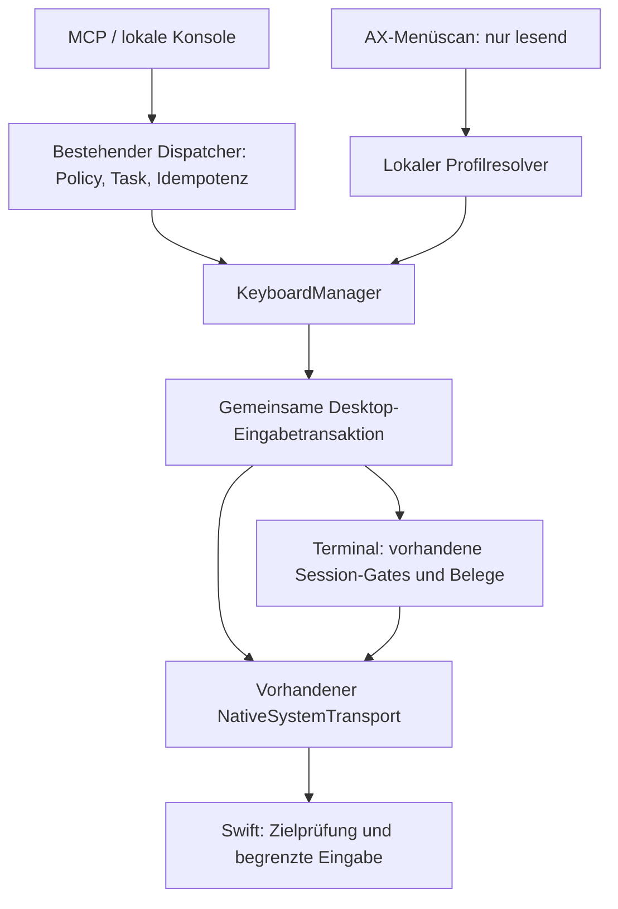

# Natives Tastaturmodul für KiraBridge – Entwicklungsentwurf

Stand: 2. November 2026. **Korrigierter Plan, vom Nutzer zur schrittweisen Umsetzung freigegeben.**
Die Korrektur hat Vorrang: native Eingabe auch langer Texte ohne Zwischenablage,
optionales anschließendes Return in derselben Eingabetransaktion, vorhandenes
Clipboard vollständig erhalten. Zuerst Tasten/Kombinationen/Text stabilisieren;
erst danach Shortcut-Discovery und lokale Profile. Fortschritte werden getrennt
in der Implementierungsakte dokumentiert.

## 1. Ausgangspunkt und gesicherte Befunde

Arbeitskopie: `fix/reliability-review-20261101`, HEAD
`d8b96dc7df6f5fb5bdb17193d279163350b4ddfd`. Produktquelle des veröffentlichten RC24:
`023f70feefcf8fcaa17b0637738b02644ad6b357`. Der letzte bestätigte Installationsstand
ist RC24 auf Intel macOS 15.7.4; ein heutiger Runtime-Neustart oder eine erneute
Live-Abnahme gehört nicht zu dieser Planung.

| Vorhandener Baustein / Fundstelle | Bedeutung für das neue Modul |
| --- | --- |
| `bridge_core/bridge.py:232`, `:548` | Komposition eines vorhandenen nativen Transports; Operationsdispatch über denselben Core. |
| `operations.py:57`, `system_operations.py:3`, `mcp_gateway/server.py:377` | Gemeinsame Capability-, Wirkungs- und Katalogverträge. Neue Funktionen brauchen ausdrücklich registrierte Modelle und Berechtigungen. |
| `task_manager/manager.py:158`, `:342` | Persistierte Argumente, Idempotenz, Freigaben, Running/Progress und Unknown bereits vorhanden; keine zusätzliche Aufgabenqueue nötig. |
| `platform_adapters/macos/system_transport.py:145` | Ein serialisierter, begrenzter Swift-Worker pro Core; Prüfung von Commit, Binärdatei, Request-ID und Worker-Generation; kein Replay nach ungewissem Effekt. |
| `integrations/desktop/SystemBridge.swift:88`, `:363` | Serielle native Requests und bestehende Handlerdelegation. Das ist der Erweiterungspunkt für native Eingabe. |
| `integrations/desktop/SystemControl.swift:46`, `:185` | PID-/Appgeneration, principalgebundene AX-Tokens, Ablauf und geschützte Terminalziele/-nachfahren. |
| `platform_adapters/terminal_app.py:1025`, `:1094` | Bereits getrennte Terminalbefehle, Literalpaste und Return, derzeit teilweise über JXA/System Events. Kein allgemeiner nativer Keyboardkanal. |
| `session_input_policy.py:112`, `permissions.py:95` | Der Eingabepuffer gilt ausdrücklich für `session.input`; neue Operationsnamen erben ihn nicht automatisch. |
| `platform_adapters/clipboard_lease.py:54`, `:229` | Unabhängiger Clipboardbesitzer, gemeinsame Sperre, generationengebundene Wiederherstellung und Cancellation-Cleanup. |
| `scripts/build_desktop_app.py:31` | Neue Swift-Dateien müssen in Build- und Quellhashlisten aufgenommen werden. |

Pfade unter `src/kirabridge/`, sofern nicht anders angegeben. Die Angaben wurden
am obigen HEAD gelesen; nach Codeänderungen sind Zeilen neu zu prüfen. Die
Dokumentation `ARCHITECTURE.md` enthält ältere Produktstände: maßgeblich für RC24
sind [Installationsbeleg](RC24-INSTALLED-20261101.md),
[Fortsetzungsreview](RELIABILITY-FOLLOWUP-20261101.md) und die Veröffentlichung.

**RC24 belegt** ein separates physisches Terminalfenster, Codex 0.166.0, lange
Literalnachricht mit einmaligem Paste/Return, unabhängig gebundene Antwort,
frühe Busy-/Stale-/Geometrieverweigerung und erhaltene ursprüngliche Sitzungen.
Die vollständige Codex-Abnahme lief isoliert mit exakt derselben Paketquelle;
der installierte Core wurde danach gesondert geprüft. Das ist keine Abnahme
beliebiger Programme, Shortcuts, Unicode-/IME-Verfahren oder Apple-Silicon-Ziele.
Die Diagnosehistorie blieb am Kapazitätslimit; neue Belege dürfen nicht von ihr
abhängen. Der Taglauf bei der Veröffentlichung wurde abgebrochen, nicht grün.

## 2. Empfohlene Architektur

Ein **kleiner fachlicher KeyboardManager im bestehenden Core** koordiniert die
Eingabe. Native Ereignisse und Zielprüfung liegen in **SystemKeyboard.swift im
vorhandenen App-Worker**. Menüerkennung und lokale Profilauflösung bleiben
getrennte Verantwortlichkeiten. Die MCP-Schicht beschreibt und reicht Aufträge
weiter; sie besitzt keine eigene Eingabelogik.

Vorgeschlagene neue Zuständigkeiten, keine schon vorhandenen Module:

- `keyboard_models.py`: strikte öffentliche Intents, Zielreferenzen und Ergebnisse.
- `keyboard_manager.py`: Freigabe, Profilrevision, Koordination und Belege; nutzt
  vorhandenen TaskManager und SystemModules statt einen zweiten Dispatcher.
- `input_coordination.py`: eine gemeinsame Desktop-Eingabeleihenfolge pro Core.
- `keyboard_profiles.py`: deklaratives Schema, Resolver und private revisionsgebundene Ablage.
- `integrations/desktop/SystemKeyboard.swift`: nativer Zielcheck, Tastenpaare,
  Layoutauflösung, Unicode und begrenzte eigene Key-up-Bereinigung.
- `integrations/desktop/SystemShortcuts.swift`: begrenztes AX-Menülesen. Bestehenden
  AX-Tokenstore gezielt gemeinsam nutzbar machen, nicht kopieren.

Öffentliche Keyboardoperationen müssen durch den KeyboardManager gehen. Interne
native Payloadmodelle bleiben separat von den öffentlich registrierten Modellen:
kein ungeprüfter Durchgriff über die automatische `SYSTEM_INPUTS`-Übernahme oder
den generischen `SYSTEM_LEAVES`-Dispatch. Terminal-App und geschützte Nachfahren
behalten `SystemControl.target(mutating: true)` beziehungsweise ihre Sessionroute.

## 3. Operationen und Zielbindung

Vorgeschlagener öffentlicher Vertrag:

| Operation | Aufgabe / Erfolgsgrenze |
| --- | --- |
| `keyboard.inspect` | Nur lesen: exakt gewählte App/Fenster/Feld, Layout, Unterstützung und Rechte des ausführenden Workers. |
| `keyboard.text` | Literaltext nativ einfügen; optionales `submit=true` sendet danach genau ein Return innerhalb derselben Transaktion und nur nach Einfügebeleg. Keine Shortcut-/Befehlsinterpretation des Textes. |
| `keyboard.key` | Genau ein abgeschlossenes Tastenpaar, etwa Enter, Escape, Tab, Backspace oder Pfeil. |
| `keyboard.chord` | Eine Taste mit definierter Modifikatormenge, etwa Command+Shift+S. |
| `keyboard.shortcuts.discover` | Menübeobachtungen mit Quelle, Revision, Kontext und Abdeckung. |
| `keyboard.profiles.list/get/put/delete/resolve` | Lokale Profile lesen/ändern oder eine Aktion ohne Ausführung auflösen; Änderungen mit Revisionsvergleich. |
| `keyboard.action` | Eine eindeutig aufgelöste Profilaktion unter denselben Ausführungsgates ausführen. |

Capability-Gruppen: `keyboard.inspect`, `keyboard.execute`,
`keyboard.shortcuts.read`, `keyboard.profiles.read/manage`. Lesende und schreibende
Operationen erhalten korrekte Wirkungs-/Queueklassen. Keine automatische Vergabe
neuer Fähigkeiten an bestehende Principals; bestehende Voll/Mittel/Fragen-Policy
und auftragsgebundene Freigaben bleiben die Grundlage. Ein Profil erteilt keine Rechte.

Ein beobachtetes Ziel enthält beziehungsweise bindet intern: Principal, App-PID
und Startgeneration, Bundle-/ausführbare Identität, AX-Fenster und fokussiertes
AX-Element, Helper-PID/Worker-Generation, Ablauf, Input-Source/Layout/Tastaturtyp
und verwendete Profilrevision. Bestehende Startzeitformate normalisieren; kein
neues frei gerundetes Identitätsformat erfinden. Titel, Koordinaten und zuletzt
aktive App sind keine ausreichenden Zielschlüssel. Lebende AX-Tokens gehören
nicht in dauerhafte Programmprofile.

Standard ist ein bereits bestätigtes fokussiertes Ziel. Explizites Aktivieren
ist ein eigener beobachtbarer Effekt mit erneuter Prüfung, kein Wiederholen
gegen einen Nutzerwechsel. Vor der ersten und jeder weiteren Eingabeeinheit
native App-/Fokus-/Feldprüfung; bei Wechsel stoppen. Kein Zurückfokussieren in
Schleifen. Prozessgerichtete Events adressieren keine bestimmte Textauswahl;
eine atomare Garantie gegenüber gleichzeitiger menschlicher Eingabe gibt es nicht.

## 4. Gemeinsame Eingabetransaktion und einmalige Wirkung

Die vorhandene Native-Transportsperre serialisiert nur native Requests, nicht
alle JXA-, Fokus-, Clipboard- und Terminalpfade. Deshalb braucht der Core eine
kurze gemeinsame Eingabetransaktion auch für seine vorhandenen konkurrierenden
Fokus-/Fenster-/AX-Eingabeeffekte.

Festzulegende Sperrreihenfolge:
**DesktopInputLease → SessionLock → ClipboardLock → NativeTransportLock**.
Nur benötigte Sperren nehmen; kein nativer Callback erwirbt eine äußere Sperre.
Interne Delegation erhält dieselbe Lease, statt sie nochmals zu erwerben.
Keine Sperre während Agentenantworten oder unbegrenzter Menüscans halten. Auch
Queue-/Lockwartezeit gehört in eine Gesamtfrist. Externe Programme und der
Nutzer selbst werden dadurch nicht gesperrt; frische Zielprüfung bleibt notwendig.
Der vorhandene native Requesttimeout beginnt erst nach Erwerb des Transportlocks;
die neue äußere Gesamtfrist muss deshalb ausdrücklich auch dessen Wartezeit erfassen.

Ein Aufruf ist ein bestehender dauerhafter Task mit derselben Idempotenz und
Freigabe. Vor Versand eines potentiell wirkenden nativen Frames ist der Versuch
konservativ gespeichert. Nach Beginn: Verlust, Timeout, Abbruch oder Teilwirkung
bleiben `unknown`, ohne automatischen Replay oder anderen Transport. Ein nativer
Antwortverlust erlaubt keine Behauptung über einen vollständig ausgeführten Prefix.
Bestätigte Chunkantworten können über vorhandenes `progress` dokumentiert werden;
Chunkanzahl bleibt deutlich unter dessen 256-Ereignisgrenze.

Ergebnis unterscheidet **angefordert**, **Versand versucht**, **native Post-Aufrufe
zurückgekehrt**, **Text/Zustand beobachtet** und **Programmaktion bestätigt**.
Ein zurückgekehrtes `CGEvent.postToPid` ist kein Verarbeitungsbeleg. Task-Abschluss
kann nur die klar benannte Versand-Scope bestätigen; ein höherer Wirkungsbeleg
benötigt einen passenden Profilverifier. RC24-Handoff-/Agentenquittungen bleiben
unverändert davon getrennt.

## 5. Native Tasten und Texte

Für Tasten/Chords zunächst Core Graphics `CGEvent`, bevorzugt prozessgerichtet mit
`postToPid`, plus unmittelbarem App-/Fokuscheck. Kein ungeprüfter systemweiter
Fallback. Apple dokumentiert diese Methoden; konkrete Appkompatibilität muss
praktisch nachgewiesen werden. [Apple: CGEvent](https://developer.apple.com/documentation/coregraphics/cgevent)

Logische Zeichen und physische macOS-Keycodes sind unterschiedliche Eingaben.
Command+Z darf auf deutschem Layout nicht pauschal eine US-Tastenposition meinen.
Benannte Spezialtasten, Return und Keypad-Enter werden ausdrücklich unterschieden.
Auflösung mit Input-Source/Layout und Tastaturtyp; Wechsel macht eine vorbereitete
Bindung ungültig. Eine gemeinsame native Zuordnung mit Vertrags-/Paritätstests
verhindert neue Python-/Swift-Tabellenduplikate.

Version 1 bietet nur vollständige Paare/Chords innerhalb eines Requests, kein
öffentliches `keyDown`/`keyUp` über mehrere Requests, keine Makrosprache und keine
beliebigen Sleeps. Eigene Down-Ereignisse verfolgen, eigene Up-Ereignisse im
Cleanup bestmöglich ausführen; physisch gehaltene Nutzertasten nicht global lösen.
Wenn möglich Modifikatoren als Eventflags statt langlebiger separater Holds
verwenden. Verhalten bei physisch gehaltenen Modifikatoren ausdrücklich prüfen;
bei Konflikt vor Start verweigern. Workerabsturz/SIGKILL zwischen Down und Up ist
keine lösbare absolute Cleanupgarantie; das bleibt ein getestetes Restrisiko.
Fn-/Medien-/Power- und globale Systemumschaltaktionen gehören zunächst nicht zur
abgenommenen Tastentabelle.

Unicode-Text einschließlich langer Texte erhält einen eigenen Weg über `keyboardSetUnicodeString`, zunächst
für bestätigte einfache Textfelder und begrenzte UTF-16-Einheiten. Grapheme nicht
blind zerlegen, Emoji/Combining-Zeichen testen, keine Normalisierung/Trimmung.
Apple weist ausdrücklich auf Frameworks hin, die die Unicodezeichenfolge
ignorieren können; IME-Komposition ist damit nicht allgemein gelöst.
[Apple: Unicode-Events](https://developer.apple.com/documentation/coregraphics/cgevent/keyboardsetunicodestring(stringlength:unicodestring:))

Lange Texte müssen vollständig über den nativen Unicodeweg funktionieren.
Die vorhandene 64-KiB-Framegrenze bleibt erhalten: bei Bedarf Text begrenzt im
Worker stagen und in mehreren internen Frames übertragen, bevor eine explizite
Commitphase eingibt. Native Unicode-Eventeinheiten dürfen keine UTF-16-Surrogate
zerlegen. Vollständigen Text und Einfügestelle nachbeobachten. Bei `submit=true`
bleibt dieselbe InputLease bis nach frischer Ziel-/Feldprüfung und genau einem
Return erhalten. Nach unbestätigtem Text kein Return, kein erneuter Textversuch.

Die gut funktionierende Clipboard-Funktion und ihre bestehenden Aufrufer bleiben
vollständig erhalten. Clipboard ist eine separat wählbare Alternative, niemals
Voraussetzung oder automatischer Ersatz für lange native Texte. Ein späterer
expliziter Clipboardauftrag behält seine vorhandene Generation-/Restore-Semantik.
`AXSet(value)` ersetzt Werte und ist kein gleichwertiger nativer Insert-Fallback.

Vorläufige Grenzen: bis zu 1 MiB UTF-8-Text, zusätzlich das vorhandene
serialisierte Tasklimit, begrenztes Staging und native Frames unter 64 KiB.
Chunkzahlen sind interne Transportgrenzen, keine Grenze, die einen Wechsel zur
Zwischenablage erzwingt. Eine Taste/ein Chord pro Aktion; lange Texte in einer
Tasktransaktion. Diese Obergrenze ist vor der Liveabnahme ein Entwicklungsziel,
keine schon gemessene Zusage. Zeilenumbrüche/Tabulatoren nur in nachgewiesen
geeigneten Feldern; den Payload weder trimmen noch normalisieren.

Der tatsächlich ausführende native Worker prüft Accessibility und
`CGPreflightPostEventAccess`, ohne automatisch Rechte anzufordern. Core- oder
RC24-JXA-Rechte beweisen keine Rechte dieses Akteurs. Senden/AX-Menülesen erfordern
keine dauerhafte globale Tastaturaufzeichnung; ein Event-Tap ist im MVP nicht
vorgesehen. Sichere/passwortartige oder nicht verlässlich klassifizierbare
Eingabefelder erhalten keine Eingabe. Eingabetexte nicht zusätzlich protokollieren:
der vorhandene TaskStore persistiert allerdings Argumente; dieser Entwurf behauptet
keine speicherfreie oder verschlüsselte Texteingabe. Schutzbedarf dafür getrennt prüfen.

## 6. Automatische Shortcut-Erkennung

Zunächst ausschließlich lesend aus AX-Menüs der exakt gewählten App:
`AXMenuItemCmdChar`, `CmdVirtualKey`, `CmdGlyph`, `CmdModifiers`, aktiviert/deaktiviert,
Menüpfad und vorhandene stabile Identifier. AX-Modifikatoren sind keine
`CGEventFlags`; insbesondere gilt Command standardmäßig, solange das
`NoCommand`-Bit nicht gesetzt ist. Übersetzung gesondert testen.
[Apple: AX-Menüattribute](https://developer.apple.com/documentation/applicationservices/carbon_accessibility/attributes),
[Apple: AXMenuItemModifiers](https://developer.apple.com/documentation/applicationservices/axmenuitemmodifiers)

Der Scan erhält Zeit-/Knoten-/Tiefe-/Seitengrenzen, revisionsgebundene Fortsetzung
und `coverage=complete/partial/unavailable`. Dynamische Menüs, interne
Editorbindungen und Web-Shortcuts sind nicht vollständig enumerierbar. Keine
Probeschüsse oder automatisches Menüöffnen. Erkennung bedeutet Beobachtung,
nicht erfolgreiche Ausführung oder implizite Freigabe.
`complete` bezieht sich ausschließlich auf den begrenzten exportierten AX-Menü-
Snapshot, niemals auf sämtliche Tastenkürzel eines Programms.

Cache pro Appgeneration, Menürevision, Sprache und Layout; nur auf Nachfrage
beziehungsweise nach Invalidierung erneuern, kein fortlaufendes Polling. Scan
aktualisiert Kandidaten, überschreibt keine bestätigte Nutzerbelegung. Standard-
oder Dokumentationsvorschläge ohne Beobachtung bleiben ausdrücklich unbestätigt.
Ein Menüeintrag ohne Shortcut bleibt ein Menüeintrag; keinen Chord erfinden.
Für eine semantische Profilaktion kann das Profil auch das bereits vorhandene,
frisch gebundene AX-`press` wählen. Dies benötigt dessen Capability und dieselben
Effektbelege. `keyboard.chord` bleibt ausdrücklich eine Tastenaktion. Nach einem
ungewissen Menü-Press niemals automatisch den zugehörigen Chord nachschicken.

## 7. Lokale Programmprofile

Empfehlung: Profile bestimmen **KiraBridges Eingaben pro Programm und Kontext**.
Das ist zunächst keine globale Umbelegung der physischen Benutzertastatur.

Core-eigene Ablage unter `data_dir/keyboard/profiles/`, Verzeichnis0700,
Dateien0600; kleine versionierte JSON-Dokumente, Größen-/Anzahlgrenzen,
symlinkfreie Zugriffe, validierter atomarer Austausch mit Revisionsvergleich
und erhaltener vorheriger Version. Vorhandene private IO-Helfer erweitern,
kein zweiter Konfigurationsdienst. JSON-Schemafehler verändern kein aktives Profil.

Ein Profil enthält: Schema/ID/Revision, App-Bundle und optional Signierungsidentität,
Version/Buildbereich, Sprache, Layout/Tastaturtyp, erlaubte Feld-/Fensterkontexte,
semantische Aktionsnamen, logische oder physische Chords, gewählte Textmethode,
zulässige Nachbeobachtung und Herkunft der Zuordnung. Keine PID-/AX-Tokens,
Texthistorie, Passwörter, Skripte oder ausführbaren Verifier speichern.

Auflösung: kompatible explizite Nutzerzuordnung, dann bestätigte Appzuordnung,
dann beobachteter Menükandidat zur Vorschau. Kandidaten allein werden nicht als
getestet ausgeführt. Mehrdeutige Profile oder widersprüchliche Chords verweigern.
App-/Layout-/Menüwechsel invalidieren die Ausführungsbindung. Vorhandene
`preferences.*` bleiben für KiraBridge-Einstellungen; keine beliebigen fremden
Preferences-Domains freischalten. Änderungen beeinflussen spätere Aufgaben;
bereits freigegebene Aufträge bleiben an ihren unveränderlichen Profilsnapshot gebunden.
Ein inzwischen geändertes aktives Profil führt vor der ersten Wirkung zur
Stale-Verweigerung, statt einen alten Auftrag auf neue Tasten umzubiegen.
Der Snapshot bleibt als Beleg erhalten; App-/Layoutbedingungen werden erneut geprüft.

## 8. Terminalintegration ohne Rückschritt

Terminal.app und Programme mit geschützten Terminalnachfahren bleiben beim
bestehenden Session-/Handoff-Vertrag. Neue generische Keyboard-APIs dürfen diese
Grenzen nicht umgehen; anfangs liefern sie dort `terminal_route_required` und
verweisen auf die bestehende Sessionfunktion. Eine kompatible interne Fassade
kann vorhandenen Terminaltext und Enter weiter an RC24 delegieren.

Vor einer späteren nativen Backendmigration sind Policy/Admission ausdrücklich
anzupassen: neue Operationsnamen werden nicht still in `session.input` umbenannt,
keine zweite verschachtelte Aufgabe erzeugt, keine Freigaben übertragen. Der
Terminalweg behält TTY, UID/Birth/PPID/Image, Busy-/Prompt-/Widget-/Geometrieprüfung,
Creationreceipt und physische Fensterbindung. `go-go-go`-Behandlung darf generischen
Literaltext nicht verändern. Enter bleibt ein eigenes Primitive gegenüber Text und Agentenbestätigung;
`submit=true` führt Text und anschließendes Return innerhalb derselben Lease aus.
Zuerst höchstens den internen Return-Primitive ersetzen; Text und Chords folgen
nur mit jeweils eigener Vergleichsabnahme. Die bisherige Fassade bleibt bis dahin
funktionsfähig, ohne automatischen Fallback nach einem begonnenen neuen Versuch.

## 9. Reihenfolge: jeder Schritt vollständig vor dem nächsten

**Freigegeben:** die folgenden Schritte einzeln abarbeiten. Die Planrevision wird
zuerst separat committed und gepusht; erst danach beginnt Produktcode.
Jede Tabellenzeile ist ein eigener Implementierungs-/Review-/Test-/Dokumentations-
und Push-Schritt. Kein Sammelcommit mehrerer unfertiger Schritte; Routinefortsetzung
nach verifiziertem Push braucht keine erneute pauschale Freigabe. Bei Fehlschlag
oder wesentlicher Planänderung stoppen und Befund klären.

| Schritt | Begrenzter Lieferumfang | Abnahmekriterium vor Dokumentation, Commit und Push |
| --- | --- | --- |
| 0 | Diese freigegebene Korrektur dokumentieren und pushen. | Native Langtexte/optionales Return und Clipboarderhalt eindeutig; noch keine Runtimeänderung. |
| 1 | Reine strikte Intents, Ziel-/Ergebnisvertrag und verlustfreier Unicode-/Frameplan. Noch keine öffentliche Effektroute. | Grenzen, fehlende Identitäten, unbekannte Felder, Surrogate, Emoji/Combining und exakte Rekonstruktion einschließlich langer Texte geprüft. |
| 2 | Rein lesende native Ziel-/Feld-/Selektions-/Rechtebeobachtung plus kleine eigene Fixture. | Alte Requests unverändert; neue Fähigkeit korrekt unsupported bei altem Worker; keine Eingabeereignisse. |
| 3 | Gemeinsame DesktopInputLease einschließlich bestehender Kira-Fokuspfade. | Konkurrenz, Lockreihenfolge und Cancellation geprüft; Clipboard-/Terminal-Verträge unverändert. |
| 4 | Genau eine native Taste. | Own-Fixture empfängt genau Down/Up; Zielwechsel null Events; Antwortverlust Unknown ohne Replay. |
| 5 | Native Kombinationen und logische/physische Layoutauflösung. | DE/US, Modifierflags, Layoutwechsel und eigener begrenzter Cleanup belegt. |
| 6 | Kurzer nativer Unicode-Literaltext. | Exakte Einfügung/Selektion einschließlich Emoji/Combining und Zeilenumbrüchen im geeigneten Feld, kein zusätzliches Return. Kein Clipboardzugriff. |
| 7 | Lange native Texte mit begrenztem Staging/Streaming. | Auch oberhalb eines nativen Frames vollständig und exakt; Unterbrechung niemals doppelt; Clipboardinhalt/-generation unverändert. |
| 8 | Optionales Return derselben nativen Texttransaktion. | Genau ein Return erst nach bestätigtem vollständigem Text und frischem Zielcheck; kein fremder Kira-Eingriff zwischen Text/Return; kein Return nach Teilfehler. |
| 9 | Reale gezielte Tastaturabnahme und kompatible Terminalanbindung. | Tasten/Chords/kurze+lange Texte und Text+Return in eigener Fixture/geeignetem Testdokument; vorhandene RC24-Pfade und Sitzungen erhalten. Terminalmigration nur pro einzeln belegtem Primitive. |
| 10 | Erst jetzt begrenzte AX-Menüshortcut-Discovery. | Korrekte Quellen/Abdeckung, Revision, Layout und NoCommand; null Probeaktionen. |
| 11 | Lokale Profile, CAS-Änderungen, Resolve/Vorschau. | Konflikte, Versions-/Layoutwechsel, Neustartpersistenz und ungültige Dateien geprüft; keine Rechteausweitung. |
| 12 | Profilaktionen und Bedienung in vorhandener Konsole. | Eindeutige Belegung und Wirkung passend verifiziert; keine automatische Änderung bestehender Clipboard-/Terminalwege. |
| 13 | Geprüften Umfang paketieren und gezielt installieren. | Paket-/Native-/Laufzeitidentität, Datenerhalt und Rückrollpunkt; tatsächlicher Plattformumfang ausdrücklich belegt. |

## 10. Tests, Aufwand und CI-Budget

Pro Schritt nur betroffene Vertrags-, Unit-/Swift-Harness- und notwendige
Integrationsfälle. Eine konkrete rote Regression vor dem Fix, gezielte Prüfung
danach; keine wiederholten Gesamtsuiten. Reale Eingabeabnahme ausschließlich in
eigener Fixture beziehungsweise eigenen leeren Testdokumenten; keine fremden
Codex-/Grok-Sitzungen. Höchstens ein eigenes zusätzliches Terminalfenster,
wiederverwenden und mit unabhängiger Abwesenheitsprüfung schließen.

Messungen erst ab realer Funktion: Warm-/Kaltstart getrennt, Native-Roundtrips,
100/1000-Menüeinträge und kurze/lange Texte; p50/p95 plus beobachtete Fehler.
Ein Zielbudget wird nach Baseline festgelegt, keine vorab erfundene Millisekunden-
oder Fehlerfreiheitszusage. Menüscan und Profilauflösung nicht in jeden Keystroke legen;
kurze native Eventpaare begrenzen den gemeinsam belegten Transport.

Für normale Schritt-Pushes auf dem Featurebranch gezielt `[skip ci]` verwenden,
keine automatischen Tags oder neuen PR-Ereignisse auslösen. Lokale Ergebnisse
explizit dokumentieren; übersprungene CI ist kein grüner Check. Ein Push gilt erst
nach unabhängigem Remote-SHA-Abgleich als abgeschlossen.

Vor einem späteren Release braucht der neue Releasecommit einen ausdrücklich
geprüften Trigger-/Budgetvertrag für seinen Tag, gegebenenfalls als eigenen kleinen
Workflow-Schritt. **Keine kurzzeitige Workflowdeaktivierung als Zuverlässigkeits-
garantie:** RC24 hat trotz dieser Maßnahme einen Taglauf ausgelöst. Bezahlte
Mac-Matrizen, zusätzliche Plattformen und Releases werden nicht beiläufig durch
jeden Entwicklungsschritt gestartet. Bestehende erforderliche Checks werden
weiter korrekt als bestanden, fehlend oder abgebrochen ausgewiesen.

## 11. Freigegebener Umfang und offene Machbarkeitsfragen

Empfohlener Zuschnitt: zuerst Intel/macOS, eigene Fixture und TextEdit; Terminal
über bestehende Sessiongates. Shortcut-Erkennung zuerst aus AX-Menüs. Profile
lokal für KiraBridge-Aktionen. Globale Remaps, dauerhafte Tastenaufzeichnung,
Makros und universelle IME-/Medientastenunterstützung gehören nicht zum ersten Umfang.

Drei Machbarkeitsfragen werden in den passenden Schritten beantwortet, nicht
vorab als gelöst ausgegeben: Unterstützung von prozessgerichteten Unicode-Events
in konkreten Apps; verfügbare Shortcuts ohne globalen Eventstream; bestmöglicher
Down/Up-Cleanup bei Workerabsturz. Bei unzureichendem Ergebnis Umfang eingrenzen
oder den Plan gemeinsam anpassen, statt Verifier oder RC24-Grenzen aufzuweichen.

Die gezielte Analyse wurde mit unabhängigen Native-/AX- und Terminal-/RC24-
Unteragenten gegengeprüft. Der korrigierte Plan ist freigegeben; einzelne Schritte
sind erst nach ihren eigenen Nachweisen und verifiziertem Push abgeschlossen.
