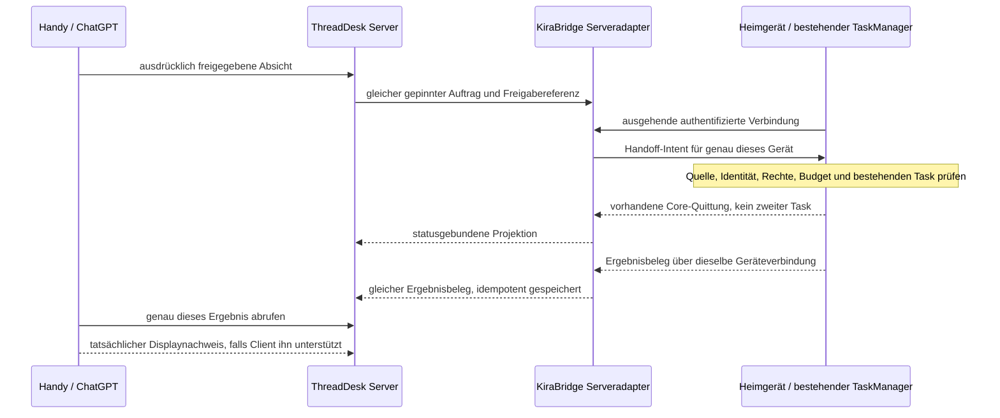

# Remote-Auftrag v1: Vertrag vor dem ersten Vertikalschnitt

`BIGPLAN-REMOTE-CONTRACT-20261105-V1` / BP-REMOTE-01, 05.11.2026.
Quelle: bestätigter [Gesamtplan](../plans/BIGPLAN-GESAMTPLAN-20261105.md),
vollständiger Nutzerbeschluss und Auftrag „weiter im Plan“.
Codex/root ist einziger Schreiber auf `feat/remote-task-contract-20261105`,
Basis `648bb1c72cd37c89012c53031a1867b1fd1bbcc5`.

**Vertragsentwurf mit ausführbaren Schema-/Kompatibilitätsprüfungen.** Kein
Remote-Endpoint, Pairing, neuer Dispatcher oder produktiver Worker implementiert.
Schema-gültige JSON-Daten sind weder authentifiziert noch freigegeben.
Kein Debian-/Handy-/Live-Test und keine aktivierte AutoNext-Aufgabenliste.

## 1. Vorhandene Grenzen und die tatsächliche Lücke

KiraBridge-Quelle dieser Prüfung ist der obige Ausgangspin; ThreadDesk wurde nur
lesend im sauberen Worktree `codex2-file-receiver-20261024` bei
`067a525798817629ae1d2b8e741d109230f54d08` geprüft.

| Bestehender Vertrag | Beleg | Anschluss und Grenze |
|---|---|---|
| ThreadDesk Server & Sync v1 | TD `docs/contracts/server-sync-v1.md`, `src/threaddesk/server_sync/app.py` | TLS, authentifizierter Nutzer und dessen privater Store, Whiteboard-/Metadaten-API, persistente Quittungen. Replikation dispatcht keine Arbeit. |
| TD-Whiteboard POST | TD `server_sync/app.py:append_whiteboard` | Akteur wird aus `request.state.user` gesetzt; Inhalt und Eintragstyp bleiben Nutzdaten. Auch ein vom eingeloggten Nutzer gespeichertes `READY` ist kein KB-Recht. |
| TD-Übergabe v1 | TD `services/handoff_contract.py`, `services/issued_handoffs.py` | Revisionsgebundene Ausgabe, Inhaltsdigest, idempotente Ausgabe und Laufbindung. Noch lokaler Vertrag; keine heutige Server-Remoteausgabe behauptet. |
| KB Core-Task | [TaskRequest](../../src/kirabridge/bridge_core/models.py), [TaskManager](../../src/kirabridge/task_manager/manager.py) | Ein Core-Task, Idempotenz je Principal, Konflikt bei verändertem Request, feste Rückroute. Persistente Taskverwaltung bleibt Ausführungswahrheit. |
| KB-Freigabe | [SecurityManager](../../src/kirabridge/security_manager/__init__.py) | Principal kommt aus Authentifizierung; Policy oder lokale exakte Einmalfreigabe. Grantverbrauch und Taskaufnahme teilen die Transaktion. TD-Token ist kein KB-Token. |
| KB-Handoff | [HandoffManager](../../src/kirabridge/handoff_manager.py) | Liest tatsächlich ausgegebenes Paket des konfigurierten Peers zurück, prüft Inhalt/Revision und bindet den Lauf. Dieser begrenzte Weg unterstützt aktuell Codex. |
| KB-AutoNext | [Modelle](../../src/kirabridge/autonext/models.py), [Manager](../../src/kirabridge/autonext/manager.py) | Explizite lokale Kartenpins/Operatorgrant, Budget, Worktreelease, Corebeleg und fachliche Annahme vor Fortsetzung. Kein beliebiges Whiteboard-Polling. |

Es fehlt der nachgewiesene Zusammenhang **TD-Nutzer und freigegebene Absicht →
festes gekoppeltes Gerät → vorhandene KB-Autorität → vorhandener Task → verifizierte
Quittung zurück**. Nicht erneut zu bauen sind TD-Server, lokale Queue, Handoff-
Ledger und Rechteengine. Ein Sync-Manifest-`device_id` benennt einen Dateireporter,
keinen kryptografisch gekoppelten Heimrechner. Ein Runtime-Instanzwechsel ist
ebenso wenig ein neues Gerät oder eine Erlaubnis zum Wiederholen eines Tasks.

## 2. Erstes bewusst begrenztes Profil

Der erste Vertragsstand beschreibt das vorhandene **Codex-Auftragsprotokoll**:
tatsächlich ausgegebener Handoff → `handoff.start`; vorhandene
AutoNext-Karte → bestehende Teamdelegation → versiegelter `agent.execute`.
Beim AutoNext-Weg wird nur die vorhandene Ausführungsbindung projiziert, kein
zusätzlicher `agent.execute` aus dem Remoteadapter gestartet. Vor Claim/Versiegelung
gibt es noch keine solche Bindungsnachricht. Neue freigegebene Karten werden nur
vom bestehenden AutoNext aufgenommen. Kein Routenwechsel zwischen beiden
Quellformen und kein sichtbarer Tastatur-/Terminal-Fallback bei Fehlern.
`local_tools=false`, `wait_for_reply=true` halten beim Kartenweg die vorhandene
begrenzte Ausführung ohne zusätzliche Bridge-Toolrechte und mit Antwortnachweis.
Codex-eigene Datei-/Werkzeugrechte bleiben durch seinen konfigurierten Sandbox-
und Worktreeumfang begrenzt; `local_tools=false` bedeutet nicht „Agent ohne Tools“.

Die Route verwendet die vorhandenen `session_scope`-Bezeichnungen:
`existing_visible_terminal` bzw. `separate_managed_session`. Aus `agent.execute`
allein folgt keine davon: [AgentManager](../../src/kirabridge/agent_manager/__init__.py)
berücksichtigt `visible_handoffs.enabled`,
[TeamDispatcher](../../src/kirabridge/team_manager/dispatcher.py) meldet den Scope.
Eine `execution_binding` benennt nur die tatsächlich belegte Route des bestehenden
Laufs, keine Anweisung zum Umschalten. Der Handoff-Intent beschreibt ausschließlich
die getrennte verwaltete Session. Der vorhandene `HandoffManager.turn` setzt
`handoff_reply=true`; bei aktivierter sichtbarer Route weist AgentManager dies
mit `visible_owned_resume_unsupported` zurück. Diese Konfiguration ist deshalb
für den beschriebenen Handoff-Start **nicht bereit**. Nicht still den sichtbaren
Schutz abschalten oder auf eine andere Route ausweichen.

Das schaltet keinen Auftrag über Queue/API um, der ausdrücklich als sichtbarer
Terminalauftrag beauftragt war. Weitere Provider und direkte sichtbare Eingaben
bleiben unverändert; ihre Remoteaufnahme braucht eigene Versions-/Capabilitybelege.
Ocean bleibt
ein unabhängiger geplanter Anwendungsadapter; ThreadDesk ist dort weiterhin optional.

## 3. Maschinenlesbare Nachrichten

[Schema](remote-task.v1.schema.json), Draft 2020-12, ausschließlich dokumentlokale
Referenzen. [Synthetische Beispiele](fixtures/remote-task.v1.examples.json) sind
keine realen Geräte, Freigaben, READY-Boardaufträge oder Laufbelege. Sie werden
nie zugestellt. Die Testprüfung verwendet den vorhandenen SchemaValidatorCache
mit leerer Referenzregistry; keine Schema-/Netzwerkbeschaffung.

| Nachricht | Inhalt und Bedeutung |
|---|---|
| `intent` | Vorschlag für den bestehenden `handoff.start` mit vollständig ausgeschriebenem nativem `TaskRequest`, Requesthash, exakter ausgegebener Quelle, Zielgerät/Workspacealias, opaker Freigabereferenz und Zeitfenster. Alle Inhalte zunächst untrusted. |
| `execution_binding` | Ausschließlich Datenprojektion des bereits geclaimten AutoNext-/Teamauftrags und seines versiegelten Core-Requests. Fachliche Karten-ID, Team-Work-ID und wirkliche Core-ID bleiben getrennt. Diese Nachricht darf niemals einen zusätzlichen Dispatch auslösen. |
| `execution_receipt` | Bindet Task, Envelopehash, nativen Requesthash und Gerät an ein vorhandenes Coreereignis und beobachtete Runtime. `queued`, `accepted`, `running`, `completed`, `failed`, `blocked`, `unknown` usw. bleiben die Corezustände. |
| `acceptance_receipt` | Separate fachliche Entscheidung mit genauem Ergebnishash und vorhandenem Operator-/vorab gepinntem Ergebnisbeleg. Core-`accepted` oder Turnende sind diese Abnahme nicht. |
| `display_receipt` | Separater Nachweis der tatsächlichen Ergebnisanzeige durch den authentifizierten Zielclient. Eine Serverpersistenz, lokale Abfrage oder Agentenmeldung kann ihn nicht erzeugen. |

Die fünf Nachrichtentypen sind Datenverträge, keine fünf neuen Endpoints.
Alle Objekte sind geschlossen. Format, Route und bestehende Argumenttypen sind
gepint; zusätzliche `approved`, `principal`, `token`, freie Pfade für den
Transport, andere Operationen oder unbekannte Versionen werden nicht übernommen.
`arguments.cwd` ist der vorhandene Coreparameter und muss vor Ausführung zur
lokal erlaubten Workspacebindung passen, kein neu erteilter Dateizugriff.

### Identität und Hashes

- `request.task_id` ist die stabile Core-ID. Für denselben Coreauftrag wird
  `idempotency_key` auf diese ID gebunden; sie wird bei Reconnect nicht neu erzeugt.
  AutoNext hat daneben eine fachliche `card_task_id` und eine bestehende `work_id`.
  `TeamManager.claim` reserviert aktuell `core_task_id = "team-" + work_id`;
  `TeamDispatcher` erzeugt und versiegelt den Request. Diese bestehende Bindung
  wird übernommen, nicht durch eine zweite Ausführung unter der Karten-ID ersetzt.
  Ein TD-Handoff kann dagegen einen historischen fachlichen Alias wie
  `thread:task` enthalten. Dieser bleibt in `source.original_task_id` erhalten;
  er wird weder als neuer Task gestartet noch blind zur Core-ID umgedeutet.
- `request_sha256` verwendet **unverändert** KB `request_hash(TaskRequest)`:
  `digest(request.model_dump())` mit sämtlichen Defaultfeldern, einschließlich
  `api_version` und `parent_id`. Das ist KB-Canonical-JSON, kein behauptetes RFC-8785-
  Format. Der Inhalt von `arguments` bleibt der **exakt versiegelte** Dictionary-
  Snapshot; `AgentInput`-Defaults nicht nachträglich hineinserialisieren. Der
  bestehende Dispatcher lässt beispielsweise `wait_for_reply` aus, dessen native
  Vorgabe weiterhin `true` ist. Keine Zahlen-, Unicode- oder Whitespace-Normalisierung.
- Bei Karten ist `source.content_sha256` SHA256 der **exakten UTF-8-Eintragsbytes**,
  nicht des neu serialisierten JSON. Bei Handoffs ist es der bestehende Digest
  des ausgegebenen Handoffpakets. Unterschiedliche Hashdomänen nie austauschen.
- Die Quittungsbindung enthält zusätzlich `envelope_sha256 = digest(envelope)` und
  bindet damit Quelle, Ziel, Freigabe und Zeitfenster. Digestgleichheit ist
  Integrität/Korrelation, keine Signatur oder Herkunftsbeglaubigung.
- `service_ref`, `tenant_ref`, `actor_ref`, `device_ref` und `workspace_ref` sind
  Namensraumreferenzen in bestätigter Konfiguration. Sie erlauben keine beliebigen
  URL-Aufrufe, fremden Tenantverzeichnisse oder Umdeutung von Anzeigetext als ID.

### Unverzichtbare Kontextprüfungen außerhalb des Schemas

JSON Schema kann weder Hashgleichheit noch Zustandschronologie, Widerruf oder
Authentizität beweisen. Ein künftiger Transportadapter muss **vor Aufnahme**
folgende Bindungen gegen bestehende vertrauenswürdige Quellen prüfen:

1. Tatsächlich authentifizierter TD-Nutzer/Tenant/Server passt zur Quellenreferenz.
   Projektscope und lesbare Quelle stimmen. Aktueller ausgegebener Handoff bzw.
   unveränderte genehmigte Karte wird zurückgelesen; Modell-/Boardbehauptung genügt nicht.
2. Gekoppelter Geräteschlüssel, lokale Authorityrevision und Workspacealias passen
   zum verbundenen Ziel. Ein anderer Client darf `device_ref` nicht selbst ersetzen.
   Gerät gewechselt/offline/ungeklärt führt nicht zu einem zweiten Zielgerät.
   Die deklarierte Route stimmt mit der tatsächlichen bestehenden Bindung und
   Konfiguration überein; `agent.execute` ist dafür allein kein Nachweis.
3. Freigabereferenz wird im **bestehenden lokalen Autoritätsweg** aufgelöst und
   bindet authentifizierten Principal, diesen Request, Quelle, Gerät und Scope.
   Kein Token, das der Absender im Body liefert, ist diese Autorität. Diese
   Remoteauflösung ist noch nicht implementiert. Ein bestehender passender
   Operator-/Policygrant soll wiederverwendet werden, keine zweite pauschale
   Nutzerbestätigung oder parallele Rechteengine.
4. Requesthash, Envelopehash und Quittungsbindung stimmen exakt; Core-`task_id` entspricht
   der Idempotenz-ID. Quelle passt zur Operation. Beim Handoff stimmen außerdem
   ID/Revision in `request.arguments` mit `source` überein; beim Kartenweg passen
   `card_task_id`, `work_id`, wirkliche Core-ID und versiegelter Request zu
   `autonext_items`, Team-Work und `core_request_hash`. Prompt, Sandbox, CWD und
   Capabilityumfang kommen aus diesem bestehenden Lauf und seiner Konfiguration;
   der Remoteadapter komponiert oder enqueuet keinen zweiten Agentenrequest.
5. Zeitfenster ist aktuell und geordnet, Freigabe unverändert und nicht widerrufen;
   Budget-/Stopp-/Leasezustand und frische lokale Zielprüfung erlauben die Wirkung.
   Ein abgelaufener Lease oder eine neue Runtime lockert keine bestehende Sperre.
   Das betrifft neue Ausführung. Späte gebundene Status-/Ergebnisbelege werden
   weiterhin abgeglichen und nicht wegen Ablauf als neuer Auftrag wiederholt.
6. Herkunft und Rechte einer Quittung werden aus ihrer tatsächlichen Verbindung
   geprüft. Executionbelege kommen vom gebundenen Heimgerät; fachliche Annahme
   vom vorhandenen Annahmeweg; Displaybelege vom tatsächlichen Zielclient.
   Ein frei erfundener `evidence.ref` ist kein Nachweis.

Der aktuelle lokale Grant bindet Principal/Request und Ablauf; neue Remote-
Geräte-/Quellenbindung darf nicht allein hineininterpretiert werden. Pairing,
gemeinsamer Vertrauensanker, Freigabeauflösung/Widerruf und Belegtransport sind
offene Gatefunktionen des folgenden Vertikalschnitts.

## 4. Zustellung, Crash und Ergebnis

Der Serveradapter vermittelt Nachrichten/Quittungen des vorhandenen Tasks, keine
zweite Ausführungsqueue. Transport-ID oder Verbindungsnonce ersetzen weder die
fachliche Aufgabe noch ihre stabile Corebindung. Aufnahme nur am gebundenen Gerät,
mit dem unveränderten bestehenden
Transaktions-/Idempotenzverhalten. Gleiche ID + veränderter Request bleibt Konflikt.

Nach verlorener Antwort zuerst den vorhandenen Task und dessen Ereignisfolge
abfragen. `created/queued` bedeutet nicht begonnen; `accepted` ist Coreaufnahme,
`running` belegter Ausführungsbeginn. `completed` ist ein begrenzter Coreabschluss,
keine automatische fachliche oder mobile Abnahme. Bei `unknown` keine zweite
Agenten-/Terminaleingabe. Der Core erlaubt spätere beweisgestützte Aufklärung,
aber keinen Neustart allein wegen Timeout, Leaseablauf oder unbekanntem Versand.
Ereignisnummern dienen Reihenfolge/Deduplizierung; gleiche Nummer mit anderem
Inhalt ist Konflikt, spätere Nummer ohne passende Bindung kein Fortschritt.

Rückweg nutzt bestehende Completion-/Outbox-/Whiteboardquittungen mit stabilen
Operationsschlüsseln. Vorhandene fehlgeschlagene/unklare Zustände und alte Belege
bleiben erhalten. AutoNext darf erst nach dem vorhandenen passenden Annahmebeleg
fortsetzen. Ein `display_receipt` allein ist keine neue Arbeitsfreigabe.

## 5. Prüfumfang und nächste Etappe

Ausführbare Prüfungen in `tests/test_remote_task_contract.py` untersuchen
Schemafehler, native Task-/Argumentkompatibilität, bestehende Hashdomänen,
explizite Routen und getrennte Quittungsformen. Insbesondere: andere Version,
selbst behauptete Freigabe/Principal, zusätzliche Felder, ungültige ID/Hashes,
falscher Quellen-/Operationstyp, fehlende Ergebnis-/Fehler-/Displaybindung.
Synthetische Quittungen beweisen **keine tatsächliche** Ausführung oder Annahme.

Im folgenden **separat konkret freizugebenden** BP-REMOTE-02 werden erst die
fehlenden Transport-/Vertrauensbindungen implementiert und isoliert geprüft:

- Derselbe zulässige Auftrag zweimal zugestellt, ein vorhandener Core-Task und
  eine Wirkung; zwei verschiedene freigegebene Aufgaben nacheinander.
- Fremder Tenant/Principal/Device, falsche Schlüssel/Source-/Grantpins, Widerruf
  und Scopeausweitung: keine Aufnahme oder Außenwirkung.
- Crash vor/nach Aufnahme, verlorene Antwort, Restart und Offlinegerät: denselben
  Task rekonstruieren, keine Ersatz-ID und kein zweites Gerät; UNKNOWN erhalten.
- Workspacelease, Budget, Stop und Timeout: kein unzulässiger Start/Folgeauftrag.
- Quittungen tatsächlich auslesen, falsche Zustands-/Ergebnis-/Clientbelege
  zurückweisen; keine mobile Live-Abnahme aus einem lokalen Ersatzclient ableiten.

Für dieses Paket keine neue Abhängigkeit, kein Plattformbuild, keine Installation
oder Runtimeänderung. Bestehende Tests werden gezielt genutzt, keine universelle
Testsuite oder Cloud-CI. Readme DE/EN und Webseiten kündigen aus einem passiven
Vertrag keine verfügbare Remotefunktion an.

Privater Checkpoint mit Quellhashes und Prüf-/Reviewbelegen:
`~/.local/share/kirabridge/backups/bigplan-remote-contract-20261105-v1/`.
ThreadDesk führt knappe gesicherte und zurückgelesene Checkpoints im vorhandenen
Koordinations-/Entwicklungsboard. Windows/Dirk bleibt parallel priorisiert;
dieser Vertrag erteilt keinen zweiten Windows- oder Ocean-Implementierungsauftrag.

## 6. Nachtrag BP-PAIR-01: Geräte-Pairing (09.11.2026)

Umgesetzt in `src/kirabridge/device_pairing.py`, angebunden an das bestehende
`RemoteRelay` (optionaler Parameter `pairing`). Keine zweite Queue, kein neuer Dispatcher.

- Das Relay legt den Geräteschlüssel aus einer lokalen Quelle vor (Datei 0600, Provider oder String); ohne oder mit falschem Schlüssel keine Ausführung.
- Bedienerseite `begin(device_ref, workspace_ref)`: Einmalcode (max. 15 min), an genau
  ein Gerät und einen Scope gebunden. `complete(code, device_ref)` liefert den
  Geräteschlüssel einmalig; gespeichert wird nur dessen SHA-256 (Datei 0600, atomar).
  Falsches Gerät verbraucht den Code; abgelaufene Freigabe wird abgewiesen.
- `revoke(device_ref)` wirkt sofort. `authorize(device_ref, workspace_ref[, key])` prüft:
  gekoppelt, nicht widerrufen, nicht abgelaufen, Scope passt, Schlüssel passt.
- `RemoteRelay.deliver` prüft vor jeder Aufnahme und erneut unmittelbar vor `task_submit`.
  Nach Widerruf, bei falschem Gerät oder falschem Scope: keine Ausführung. `reconcile`
  bleibt lesend und wird nicht gesperrt (Belege vorhandener Tasks bleiben abfragbar).
- Offen für die Liveabnahme: Serverseitige Anmeldung des Heimgeräts mit dem Schlüssel
  über den Tunnel (BP-DEBIAN-02), Deploy auf den Server, Speicherort der Pairing-Datei.
Tests: `tests/test_device_pairing.py` (Relay-Test braucht den gepinnten ThreadDesk-Quellstand).
