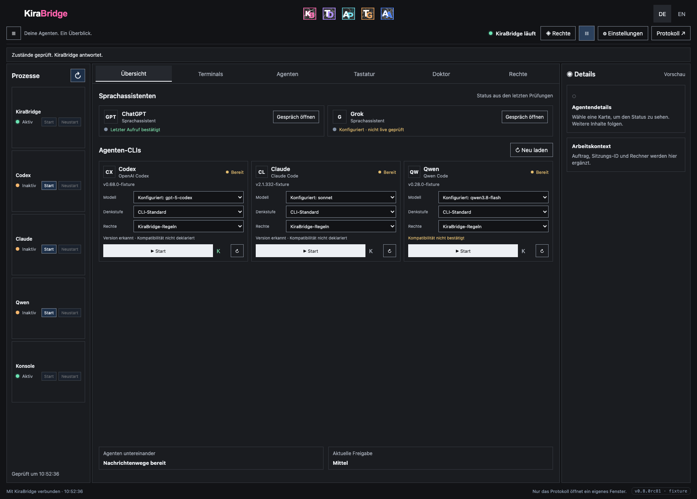
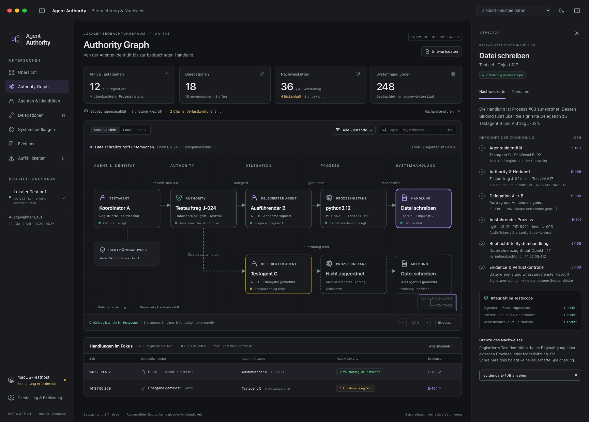

# KiraBridge P1 visual acceptance evidence

Both images are 1728 × 1240 pixels (1× scale), the same window size.

| KiraBridge P1 console | Agent Authority visual reference |
|---|---|
|  |  |

The KiraBridge image is a live render of the changed console served by an isolated temporary Bridge with synthetic CLI inventory, connection checks, and coordinator role. It verifies the layout and displayed state; the probe did not click Start or launch a CLI. It is not a screenshot of the user's production instance.

The Agent Authority image is the archived app screenshot `docs/macos-app-design-20261012/hauptansicht-dark.png` from worktree `family-design-20261112` at source revision `0b27b01`. It is a dated design comparison, not a fresh screenshot of the currently installed app.

## Verified card behavior

- ChatGPT and Grok cards render from the existing connection/status response. The screenshot distinguishes a recent confirmed ChatGPT call from a configured but not live-checked Grok connection.
- Codex, Claude, and Qwen cards render service state and CLI version/compatibility from the Bridge snapshot and `agent_inventory`; the coordinator `K` is derived from the current team coordinator role.
- Model, reasoning effort, and permission selectors are present. Start calls the existing authenticated visible-terminal session-open path with validated options. The browser probe intentionally does not trigger this consequential action.
- Refresh re-reads status and CLI inventory. Qwen's observed `0.28.0` is shown with compatibility unconfirmed when inventory says unsupported.
- The two sidebars can be resized by pointer or keyboard, collapsed, and their layout preference persists locally.

## Deliberate deviations / limits

- Provider artwork is not present in the KiraBridge console assets. The cards use compact `GPT`, `G`, `CX`, `CL`, and `QW` text marks; these are explicitly wordmarks, not copied brand logos.
- The right sidebar remains a placeholder for agent details and work context, as scoped for this first slice. The process sidebar remains KiraBridge-specific.
- Agent Authority's macOS-specific permission UI is not copied. KiraBridge keeps its own permissions screen and safe start controls.
