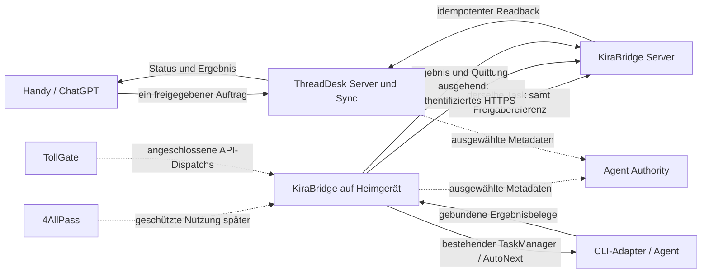

> **Nicht maßgeblich. Maßgeblich ist ThreadDesk-Thread `6b5b73b9de36` (Master mit Etappen E01–E09; Status im Board `188ce4729a62`; Nutzerbeschluss 09.11.2026). Diese Datei ist Archiv bzw. technischer Spiegel.**

> Historischer Quellenstand aus `21d2e2cad8e9930931b02031addfc25d819a9ed3`,
> bei der Integration am 06.11.2026 bewahrt. Aktueller Quellen-, Prüf- und
> Installationsstand: [RC40-Integrationsnachweis](../RC40-INTEGRATION-INSTALL-20261106.md).
> Datierte Plan- und Gateangaben sind keine neue Auftrags- oder Berechtigungsquelle.

# BIG PLAN: Gesamtentwicklungsplan und koordinierter Einstieg

Auftrag `BIGPLAN-GESAMTPLAN-20261105-V1`, eigener Plan von Codex/root,
Fortgeschriebener Stand 6. November 2026. Technische Koordination: Codex; übergeordnete Ziele,
zusätzliche Freigaben und produktive Entscheidungen: Kira und Nutzer.
Planbranch `feat/bigplan-coordination-20261105`, Basis
`511f289fc5109f5d6893d5df8843254628c385ba`. Dies ist ein Entwicklungsplan mit
belegtem Einstieg, keine Behauptung einer fertigen Remoteplattform.

## 1. Maßgebliche Quellen und Herkunftsgrenzen

Gelesen: aktueller Nutzerauftrag, Big-Plan-Skill **1.2.0**, WORKFLOWS **1.0.1**,
REFERENCES/TEMPLATES, einschlägige Repoanweisungen und vorhandene Verträge;
Koordinationsboard `482f593429ad` einschließlich Threadrevision **32**,
Entwicklungsboard `188ce4729a62`, Produkt-/Serverthreads und Git-/Runtimebelege.
Separate lesende Faktenprüfung von 4AllPass, TollGate und Agent Authority liegt vor.

Die genannte Originaldatei
`/big plan/Big-Plan-Architektur-und-Remote-2026-11-05.md` aus der
ChatGPT-Bibliothek konnte zunächst nicht direkt gelesen werden. Lokale
Dateinamensuche, die verfügbaren ChatGPT-Pages-/Space-
Kataloge einschließlich ihrer Folgeseiten und drei relevante gespeicherte
ThreadDesk-Bibliotheksindizes lieferten keinen Zugriff auf diese Datei. Die
ThreadDesk-Indizes sind dort noch nicht vorhanden. Das beweist nicht, dass die
Datei in der Bibliothek fehlt. Der Nutzer hat den **vollständigen aktuellen
Architektur- und Remote-Beschluss anschließend im Chat bereitgestellt**.
Er ist die aktuelle Primärquelle und mit Herkunft unter
[Architektur- und Remote-Beschluss](sources/BIGPLAN-ARCHITEKTUR-REMOTE-BESCHLUSS-20261105.md)
gesichert. Der Plan wurde daran abgeglichen; die inhaltliche Quellenlücke dieses
Beschlusses ist geschlossen. Bibliotheks-Dateimetadaten und die dort genannten
drei älteren Masterpläne wurden nicht zusätzlich direkt gelesen. Die
Koordinationsnotiz bleibt sekundäre Zusammenfassung. Vor späteren Änderungen
an älteren Detailverträgen sind deren Originale gezielt abzugleichen; das ist
kein pauschaler Stopp bereits autorisierter unabhängiger Arbeit.

Neue bestätigte Beschlüsse haben Vorrang vor historischen Plantexten:

- Zielbild: Handy/ChatGPT → Debian/ThreadDesk → KiraBridge-Transport →
  Heimrechner/Agent → Ergebnis und Belege zurück an ThreadDesk.
- Fünf eigenständige Produkte; Agent Authority **beobachtet ausschließlich**.
  Der alte Serverplan vom 22.10. sagt noch „Agent Authority entscheidet
  Berechtigungen“. Dieser Teil wird durch die bestätigte Entscheidung vom
  05.11. ersetzt; der historische Branch bleibt unverändert erhalten.
- Erste priorisierte CLI-Gruppe: Codex, Grok Build, Claude Code, Gemini, Cursor.
  OpenCode, GitHub Copilot CLI und Aider bleiben eingeplant und werden erhalten.
- Windows für Dirk bleibt ein praktischer Lieferpfad. Er wartet nicht darauf,
  dass alle acht CLI-Module oder sämtliche Serverfunktionen fertig sind.
- Alte ThreadDesk-Anweisungen mit ausschließlich ThreadDesk-Umfang beschreiben
  frühere Aufträge. Der aktuelle ausdrückliche Fünf-Produkte-Auftrag erweitert
  den Planungsumfang, ohne alte Daten, Quellstände oder Prüfgrenzen umzudeuten.
- Ergänzender Nutzerauftrag vom 05.11.: eigener Ocean-MCP-Adapter für Dirks
  bestehende Plattform. Nur Planung und Schnittstellenprüfung, keine ungefragte
  Implementierung. Live-Sprache → KiraBridge → Ocean-Adapter → Ocean;
  ThreadDesk bleibt unabhängig und optional. Details im
  [Ocean-Adapterplan](OCEAN-MCP-ADAPTER-20261105.md).

## 2. Tatsächlicher Bestand vor neuen Aufträgen

| Produkt/Strang | Vorhanden und Quellbezug | Grenze des Nachweises |
|---|---|---|
| KiraBridge Desktop Mac | Laufende **0.8.0rc39**, Quelle `8d331314b608d247ba160e04a898f9498cbb22d3`, 189 Pythonmodule; PID40336, Instanz `b988e7acdc284bbfb7da161a18585c46`. Dokumentationshead `511f289`. Aufgabenverwaltung, Policies, SQLite, TeamDispatcher, MessageReceiver, native Terminal-/Tastaturtechnik, CLI-Semantikregistry vorhanden. | Livehealth und Paketquellpfad frisch gelesen. Native Codex-/AutoNext-Abnahme ist für den dokumentierten Paketstand belegt; daraus folgt keine aktuelle universelle Grok-/Browserchat-/Windows-Abnahme. |
| AutoNext | `2a8d2fe` integriert; ausdrückliche Boardpins, Startanker, Claim/Lease, Outbox/Readback, Abnahme vor Folgeauftrag. Zwei echte read-only Folgeaufträge auf eigenem Intel-Codex-Ziel einmalig abgeschlossen. | **Aktuell disabled**, keine dauerhafte freigegebene produktive Aufgabenliste. `b3c7336` enthält einen separaten Folgefix zu alten unbekannten Receiver-Scopes; nicht als installiert behandeln. |
| Windows | RC33-Kit und native Win32-/Tastatur-/MCP-/Fenster-Vorarbeiten vorhanden. RC33-Quelle `ce0687dd8831dae261bf285922a146bcf3aedc41`; Kit-SHA256 `1002e68cbef96c7fd9a383d542beb5abc727f5843316352a65638fe4266a919a`. | Kein RC39-Paritätsnachweis. Mac-Terminalsemantik und Mac-Abnahme sind keine Windows-Unterstützung. Windows-spezifische Dateien waren im letzten Audit unverändert, gemeinsamer Kern inzwischen verändert. |
| Groks Windows-Kandidatenpatch | **Geliefert**, `070ea70eed2600fd276dcb6ab5ea122cd274f481`, eigener sauberer Worktree `grok-windows-candidate-20261105`. Nach unabhängigem Review mit drei Rootkorrekturen im Koordinationsbranch als `ae699cb` integriert. | 69 gezielte Tests bestanden; Versions-/Berichtwechsel-/Dateinamenbefunde geschlossen. Kein echtes Windows-Paket gebaut, keine native Windows-Abnahme. Nicht erneut beauftragen. |
| ThreadDesk | Frisch integrierter Defaultpin `067a525798817629ae1d2b8e741d109230f54d08`; geeigneter sauberer Leseworktree `codex2-file-receiver-20261024`. ThreadService/JsonStore, MCP, Whiteboards, Dateiempfang, Graph-/Bibliotheksfunktionen vorhanden. | Der alte Hauptworktree ist geändert und nicht die geeignete Basis für einen Neubau. Installierte Desktopquelle wurde in dieser Analyse nicht neu attestiert. |
| ThreadDesk-Projektgedächtnis | Andere Sitzung lieferte Featurekandidat `e65016fb987ba5ded5cde959eae6ce20eb173a66`, gemeinsamer lesender `project.memory`-Command/UI/CLI/HTTP/MCP. Ergebnisbeleg Board188ce4729a62#210; Koordination `482f593429ad/c154c9769e17` meldet M2 `54624d8` und weist M3 Planrevision/Wiedereinstieg derselben TD-Sitzung zu (Karte `188ce4729a62/1efb9741ba1f`). | Berichtete 310 Root- und 30 unabhängige Tests gehören zum M1-Kandidaten. Kein hier behaupteter Main-/Livepeer-/Desktop-Installationsnachweis; M2/M3 nicht doppelt beauftragen oder den fremden Arbeitsbereich übernehmen. |
| ThreadDesk Server & Sync | Bereits implementiert und integriert: PR89, Merge `770bbc9f0c0a02699cc93cad47d2e2c3782f7080`, heute im neueren Defaultstand. Eigene Server-/Client-Entrypoints, Browser, TLS/Auth, Metadaten, Dateien/Chunks, Offlineinventar, Konflikte, Restart und Backup/Restore. | Historische Linux-/TLS-/CI- und lokale Belege vorhanden; PR-Merge frisch bestätigt. Kein daraus abgeleiteter aktueller produktiver Debian-Installationsstand oder Remote-Auftrag bis zum Heimagenten. **Diesen Server nicht neu entwickeln.** |
| KiraBridge Server | Remote-Ref `development/server` frisch bei `e025dee524bd5a00712cc1f51d2f8a52941ff5fd`. Bestehender Plan und gemeinsamer MCP-/HTTP-/Taskkern als Ausgangsbasis. | Serverplan sagt ausdrücklich „Planung, keine Server-Implementierung oder Bereitstellung“. Kein belegter gerätegebundener Heimrechner-Auftragsrelay. Branch ist kein Vorfahr von `511f289`; keinen alten Branch blind über aktuellen Core mergen. |
| 4AllPass | Integrierter Defaultpin `0b66a2fda7fcc831762e732eb20084137fa6029d`. Tresor/PWA/Extension und geschützter synthetischer Executorvertrag vorhanden; integrierte Source sperrt maschinelle Rohgeheimnisübergabe. | Veröffentlichter RC2 ist älterer Stand `60eef0a`; RC3-Kandidat ist kein ausgelieferter Fix. Produktive Secretisolation, vertrauenswürdiger Vault→Executor-Transfer und KB-Originbindung fehlen. Kein heutiger produktiver Secret-MCP-Dienst behauptet. |
| TollGate | Defaultpin `6676bcfc69f85e77fec6192bc51ad8f9c0b26740`, Version1.0.12. Gateway/MCP/n8n, WorkflowControl mit atomarer Reserve/Dispatch/Settlement-Zuordnung und persistenten Stopps vorhanden. | Synthetische Vertragsbelege; kein allgemeines hartes Dollarcap für Abo-CLIs. Aktueller produktiver Gateway-/Serverstand nicht neu beobachtet. |
| Agent Authority | Observer-Master `75fb14e99a50b967b8624191f0178963c433fbd9`; Projektionen, Warnregeln, CLI/Reader und native UI vorhanden. Separater Browser-/Debianzweig `e69abcd07e62873f4276fa3d1ff6ffd71a7b0327`. | Browserzweig enthält heutige `workflow.py`/`workflow_rules.py` des Masters **nicht**. Historischer Debianbeleg gehört zu `27db3a8`/Paket `f512ab6…`, nicht automatisch zu späteren Accountgrant-Updates. Keine Freigabe-/Budget-/Stoppautorität. |
| Ocean als externe Anwendungsintegration | Plattform `ocean.com.de` und Developer-Portal eindeutig zugeordnet; aktuelle öffentliche Bot-/Skill-/Medien-/Spielverträge und öffentlicher JWKS-GET geprüft. Bestehende Recherche und Ocean-Thread `30e962aaed81` erhalten. | Kein implementierter Ocean-MCP-Adapter, kein Login oder fachlicher API-/Live-Test. Allgemeiner Galerie-/Speichervertrag, Projektfreigaben und Servergarantien offen; [eigener Plan](OCEAN-MCP-ADAPTER-20261105.md). |

Die Hauptworktrees aller fünf Produkte enthalten teilweise alte, gestagte oder
unversionierte Arbeit. Sie werden nicht zurückgesetzt, gestasht oder als „aktuelle
Masterfassung“ überschrieben. Pro neuer Änderung wird ein geeigneter verifizierter
Stand verwendet. Der aktuelle KiraBridge-Remote-main ist `34adc03`; er ist weder
die installierte Quelle noch Groks Kandidat. Offene gestapelte PRs ersetzen keinen
Integrationsnachweis. Initial gelesen wurden u.a. KB#57/#55/#54 und TD#98/#96;
der PR-Suchlauf war auf 20 Treffer begrenzt, keine vollständige Mergefreigabe.

## 3. Architekturentscheidungen

### 3.1 Produkte und Verantwortung

| Baustein | Besitzt | Besitzt nicht |
|---|---|---|
| ThreadDesk Desktop und Server & Sync | Projekt-/Thread-/Dateikontext, Aufgabenabsicht, Whiteboard, freigegebene Katalogreferenzen, replizierte Status-/Ergebnisansichten, Sync/Versionen/Konflikte | Shellausführung, eigenständige Agentenberechtigungen oder Modellkostenfreigabe |
| KiraBridge Desktop | Lokale Ausführungsautorität: Policies, TaskManager, Idempotenz, Worktreebesitz, Prozess-/Sitzungsidentität, semantische Dispatchs und belegte Ergebnisse | Tresorentschlüsselung oder pauschale Übernahme von Boardtext als Befehl |
| KiraBridge Server | Authentifizierter Geräte-/Nachrichtentransport und Capabilityvermittlung desselben Kerns, beschränkte Serverfähigkeiten, Referenzen auf vorhandene Aufgaben und Belege | Zweiter Heimrechner-Executor, konkurrierender Dispatcher oder permanente Chef-KI |
| 4AllPass | Identitäten und kontrollierte Geheimnisnutzung über seinen geschützten Vertrag | Ungeprüfte Rohsecretübergabe an Agenten/LLM-Kontext/Whiteboards |
| TollGate | Kostenadmission und Nachweis/Settlement für tatsächlich angeschlossene quotierbare API-Dispatchs | Erfundenes Abo-Budget, universelle Rechnungsgarantie oder Agentenidentitätsnachweis |
| Agent Authority | Autorisierte lesende Projektion ausgewählter Ereignisse und Evidenz, Warnungen und Nachweisgrenzen | Genehmigen, Dispatchersteuerung, Widerruf fremder Rechte oder Stoppen fremder Arbeit |

KiraBridge bleibt **ein Codekern im bestehenden Repository** mit Desktop- und
Serverprofilen/Entrypoints. Betriebssystemadapter importieren den gemeinsamen
Kern; Server- und Headlessprofile behaupten keine lokalen GUI-Fähigkeiten.
ThreadDesk Server bleibt im ThreadDesk-Repository mit seinen eigenen
Installations-/Syncregeln. Zunächst werden genau diese erforderlichen Dienste
auf bestehender Infrastruktur verbunden; keine zusätzliche KI-Zentrale.

### 3.2 Ein Auftrag und eine Ausführungsautorität

Für den ersten vertikalen Ablauf wird der existierende HTTP-/MCP-/Sync-Unterbau
genutzt. Das Heimgerät baut den authentifizierten ausgehenden HTTPS-Kanal auf;
keine vorausgesetzte Portfreigabe im Heimnetz. Eine Verbindungserweiterung wird
nur ergänzt, soweit der vorhandene Transport sie tatsächlich benötigt. Browser-
Returnhilfe und Chrome-Prototyp sind optionale Routen, keine neue Autorität und
kein Ersatz für ein extern blockiertes Werkzeug.

Für diesen Remoteablauf gibt es **einen autorisierten mobilen Auftragseingang im
ThreadDesk-Auftragsweg**. Das ist keine ThreadDesk-Pflicht für unabhängige
KiraBridge-Anwendungsadapter wie den gesonderten Ocean-Pfad in Abschnitt 3.4.
Aufgabe und zugehörige Herkunfts-/Freigabereferenz werden revisionsgebunden
gespeichert; KiraBridge Server vermittelt genau diesen Datensatz. Es gibt keine
zusätzliche direkte Handy→KiraBridge-Auftragsanlage, keinen zweiten Freigabekatalog
und keine zweite Benutzerbestätigung desselben Auftrags. Der bestehende
KiraBridge-Policykern prüft beim Akzeptieren Herkunft, Gerät und erlaubten Scope;
eine abweichende oder nicht belegbar autorisierte Kopie wird abgelehnt. Die
gespeicherte Referenz ist kein selbst erteiltes Recht des ThreadDesk-Dokuments.
Der konkrete Nachweis dieser Bindung gehört zu BP-REMOTE-01/02 und ist noch
keine behauptete Funktion des heutigen Serverstands.

**Eine stabile fachliche Auftragsreferenz** verbindet Absicht, Freigabe und
Transport mit dem bestehenden Core-Task. Vorhandene TD-Handoff-, Karten-, Team-
Work- und Corekennungen bleiben getrennt und dauerhaft aufeinander gebunden;
sie werden nicht umbenannt oder bei Wiederaufnahme als zweite Ausführung angelegt.
Das bestehende lokale TaskManager-Ledger bleibt Ausführungswahrheit.
Serverzustellung und ThreadDesk-Anzeige sind Quittungen/Projektionen dieses
Auftrags, keine zweite Ausführungsqueue. Persistente Transportquittungen werden
mit den vorhandenen Idempotenz-/Outboxfunktionen abgeglichen.

Jede freigegebene Absicht bindet ein bestimmtes Gerät und einen bestimmten
Principal/Scope. Mehrere Geräte können verschiedene Aufträge bearbeiten; ein
Auftrag darf nicht gleichzeitig an mehrere Heimgeräte failovern. Solange die
Ausführung des ersten Ziels unklar ist, entsteht kein Ersatzauftrag. Das löst
die Doppelclaim-Gefahr, die zwei voneinander unabhängige lokale SQLite-Claims
allein nicht über Geräte hinweg lösen würden.

Der gemeinsame Remotevertrag bindet mindestens Protokollversion, Auftrags- und
Idempotenz-ID, authentifizierten Auftraggeber, Projekt/Thread, Zielgerät,
Freigabe-/Inhaltshash, erlaubten Scope/Route, Ablauf-/Widerrufsbezug und
Ergebnisreferenzen. Die Freigabe kommt aus dem autorisierten Auftragsweg;
**READY als freier Boardtext ist keine Freigabe**. ThreadDesk-Metadaten oder
Modellantworten dürfen keine Ausführungsrechte erzeugen. Geräteauthentifizierung
und Pairing müssen vor Remoteausführung praktisch nachgewiesen werden;
das konkrete kompatible Nachrichten-/Freigabeschema wird im Vertragsarbeitspaket
gegen die vorhandenen APIs festgelegt, nicht hier als bereits implementiert verkauft.

### 3.3 Offline, Sync und unklare Wirkung

- Ist das Heimgerät ausgeschaltet/offline, bleibt der Auftrag als nicht zur
  Ausführung übernommen sichtbar. Der Server behauptet keine Agentenarbeit.
- Reconnect fragt vorhandene Quittungen/Corezustände ab. Ein verlorener Versand-
  oder Ergebnisabruf führt nicht zu einer zweiten Eingabe oder Modellausführung.
- Intent-/Scopeänderungen benötigen einen neuen gültigen Inhalts-/Freigabepin;
  Konflikte aus bidirektionalem Sync dürfen keine stillen Berechtigungsänderungen
  bewirken. Originale, Historie und UNKNOWNs bleiben erhalten.
- „Auch offline“ betrifft verifizierte Dateikopien, nicht die Erlaubnis, einen
  Auftrag auf einem anderen Gerät auszuführen. Die vorhandenen Syncgrants und
  privaten lokalen Dateifreigaben bleiben getrennt von replizierten Verweisen.
- Zustellung, Claim, Arbeitsbeginn, Turnende, fachliche Abnahme und tatsächliche
  mobile Ergebnisanzeige bleiben unterscheidbare Zustände und Belege.

### 3.4 Eigenständiger Ocean-MCP-Adapter

Live-Sprache → vorhandene KiraBridge-MCP-/Policy-/Taskverwaltung → eigener
Ocean-Adapter → Ocean. Chat, Bilder/Galerien, Speicher und browserbasierte Spiele
erhalten eine eigene Capabilitymatrix. Ocean bleibt externes Produkt; der Adapter
ist kein CLI-Modul und führt keine zweite Queue oder Rechteengine ein.
ThreadDesk ist optionaler, ausdrücklich freigegebener Datenaustauschpartner.
Der Kern besitzt lokale Ausführungsrechte; Ocean-Konten, Bot-/Raumrollen oder
Dateilinks erteilen keine Tastatur-, Maus-, Fenster-, Programm- oder Terminalrechte.
Vorhandene OS-Fähigkeiten werden pro Plattform und Route wiederverwendet und
nachgewiesen. Fehlende APIs führen nicht zu einem stillen GUI-/Terminal-Fallback.

Der [Ocean-Adapterplan](OCEAN-MCP-ADAPTER-20261105.md) dokumentiert die frisch
geprüften offiziellen Portalverträge, den Schnittstellenentwurf, Authentifizierung,
Berechtigungen, Sicherheit, Meilensteine und Tests. Die ältere statische APK-
Analyse ist Herkunftsbeleg, keine öffentliche API-Freigabe. Nur Planung beauftragt;
Implementierung, Projekt-App, echte Tests und produktive Aktivierung bleiben offen.

## 4. Plattform- und CLI-Migration

Die vorhandenen `agent_manager`-Provider und `cli_adapters` haben unterschiedliche
Verträge: strukturierter Agentenweg versus sichtbare UI-Semantik. Diese werden
unter einer gemeinsamen Capabilityabfrage beschrieben, nicht zusammenphantasiert.
Ein UI-Problem wählt keinen undokumentierten Queue-/API-Ersatzweg.

| CLI | Belegter Ausgangspunkt | Nächste Ergänzung/Abnahme |
|---|---|---|
| Codex | Provider plus eigener UI-Adapter, Copy/Scroll/Status/Model-Zustände; reale Intel-Handoff-/Antwort-/AutoNext-Belege | Grenzen für neue Verbindung, Tab/Fokus und Remoteauftrag exakt pinnen; Windows-/Linux-Routen separat |
| Grok Build | Vorhandener Connector/Provider, eigener UI-Adapter, tatsächlich arbeitender sichtbarer High-Partner | Bestehende Übergabeprobleme mit langen/wrapped Texten, Fokus und Placeholder als eigene belegte Fähigkeitengrenzen prüfen; keine pauschale Return-/Dialogfreigabe |
| Claude Code | Strukturierter Adapter vorhanden; historischer Loginstatus vom 19.10. war nicht angemeldet | Bestehenden Login und CLI-Version ohne Modellkosten neu feststellen, dann kleinste genehmigte echte Route testen; sichtbare Semantik separat |
| Gemini | Strukturierter Adapter vorhanden; historisch kontobedingte Ablehnung | Aktuellen bestehenden Zugang feststellen; kein kostenpflichtiger API-Ersatz. Danach gemeinsamer Vertrags-/Routingtest |
| Cursor Agent | Im priorisierten Zielumfang; kein passender vollständiger Adapter im geprüften Registrybaum belegt | Dokumentierte installierte Schnittstelle bestimmen, danach kleinsten Adapter mit expliziten Fähigkeiten bauen |
| OpenCode | Adapter und historischer isolierter lokaler Textantwortbeleg vorhanden | Bewahren; heutige Version/Route und Werkzeug-/Fortsetzungsgrenzen getrennt ausweisen |
| GitHub Copilot CLI | Adapter vorhanden; historischer isolierter Zugang nicht angemeldet | Bewahren; aktueller freigegebener Zugang und beobachtete Fähigkeit entscheiden spätere Abnahme |
| Aider | Fest eingeplant; in dieser Bestandsaufnahme kein vollständiger Provider-/UI-Adapter belegt | Nachrangiges eigenständiges Adapterpaket auf demselben Vertrag |

Die fünf priorisierten Adapter werden nacheinander entlang realer Fähigkeitslücken
ergänzt, bereits vorhandene Implementierungen werden migriert statt neu erfunden.
Version, OS, Route, Menü-/Slash-/Returnsemantik und Nachweisgrad gehören zur
Capabilitymatrix. Keine Garantie „alle Funktionen unter allen CLIs“.

Windows nutzt seine vorhandenen Win32-/Tastatur-/Fenster-/Harnessbausteine und
den gemeinsamen Core. Noch fehlende sichtbare Terminal-/Sitzungsfunktionen werden
zuerst als Lücke reproduziert und dann im Windowsadapter ergänzt. Native Windows-
und WSL-Ergebnisse bleiben getrennt. Linux Desktop verwendet den gleichen Core
mit tatsächlich verfügbaren X11-/Wayland-/Terminalfähigkeiten; Debian Server hat
ein beschränktes Headlessprofil. Kein Mac-Menüparser im allgemeinen OS-Kern.

## 5. Prüffähige Etappen und nächste Arbeitspakete

Dies ist ein Planregister, **keine zweite Queue und keine automatische READY-
Freigabe**. Bestehende Paket-IDs werden weiterverwendet. Neue Implementierungs-
pakete erhalten vor Zustellung ihren konkreten Scope im vorhandenen ThreadDesk.

| Paket/Etappe | Ergebnis und Abnahmekriterium | Zuständigkeit / Abhängigkeit / Status |
|---|---|---|
| BP-00 Quellen und Besitz | Originalquellen/Entscheidungen mit Herkunft, tatsächliche Pins und laufende Pakete; keine doppelte Übernahme. | Codex. Bestand und vollständiger aktueller Nutzerbeschluss gelesen; Bibliotheks-Dateimetadaten/ältere Referenzpläne nicht direkt geprüft. Dieser Plan ist der erste eigene konsolidierte Stand. |
| `BIGPLAN-GROK-WINDOWS-CANDIDATE-20261105-V1` | Gelieferten `070ea70` unabhängig auf RC33-Erhalt, Kandidatenintegrität und Ablehnung alter Nachweise prüfen; passende vorhandene Tests ausführen; nur bei Bestehen integrieren. | **Quellschritt abgeschlossen:** Grok geliefert, Codex korrigiert, unabhängiger Review freigegeben, 69 Tests, Integration `ae699cb` im Featurebranch. Native Liefergates bleiben offen. |
| `bigplan-windows-parity-audit-20261105-v1` | Vorhandener gepinnter Boardauftrag `c803df9cc369`, ausschließlich Paritätsbericht mit konkreter nächster Windowsänderung. | Unter derselben ID von Codex/root abgeglichen und abgeschlossen, kein zweiter Queue-/Corestart. [Bericht](../BIGPLAN-WINDOWS-PARITY-20261105.md): zehn Windowsdateien unverändert, historisches Kit frisch gehasht; gemeinsamer Core und aktueller Gastpass offen. |
| `BIGPLAN-WINDOWS-EVIDENCE-PRODUCER-20261105-V1` | Fehlende Quellenbindung direkt im vorhandenen Gast-Runner erzeugen, nicht alte Reports beschriften. | Opt-in Producer und gemeinsame Inventarprüfung implementiert; [Vertrag und Grenzen](../WINDOWS-CANDIDATE-PRODUCER-20261105.md). Portable und lokale PowerShellprüfungen mit synthetischen Kindern; native Win32-/Kit-/Dirkabnahme bleibt offen. Kein VM-/Cloud-/Installstart. |
| `BIGPLAN-WINDOWS-NATIVE-20261106-V1` | Den eingefrorenen Kandidaten auf dem vorhandenen eigenen Fix1-Gast nativ prüfen, Altinstallationen/UNKNOWNs erhalten. | [Tatsächlicher Preflight](../WINDOWS-NATIVE-PREFLIGHT-20261106.md): Offline-Payload179bb6f vollständig abgeglichen, laufende VM/eigene PS5.1/x64 und neue WorkName-Abwesenheit belegt. UTM-US/Guest-DE sowie Run259-Zeichengrenze geklärt. Sechs Kandidatenphasen noch nicht gestartet; Restricted erfordert konkret angefragte Freigabe für den dokumentierten einmaligen Testprozess-Override. Kein neues Kit/Installationspass. |
| BP-REMOTE-01 gemeinsamer Vertrag | Bestehende TD-Server-/MCP-, KB-Task-/Handoff-/AutoNext-Verträge verbinden. Ein Task, ein Zielgerät, getrennte Zustände, Rechtequelle, Quittungen und Versionskonflikte; maschinenlesbares Schema und Negativtests. | **Passiver Quellschritt abgeschlossen:** [Vertrag v1](../contracts/remote-task-v1.md), Schema und synthetische Kompatibilitätsfälle auf `feat/remote-task-contract-20261105`; 61 gezielte Prüfungen bestanden, finaler unabhängiger Grok-Review bestätigt. Codex alleiniger Schreiber. Kein Remoteauth-/Transportadapter oder produktiver Start. |
| BP-REMOTE-02 isolierter Vertikalschnitt | Bereits vorhandenen TD-Server und aktuellen KB-Core in separater lokaler Testumgebung verbinden: ausdrücklich autorisierter Auftrag → eigener Agent → Ergebnis in demselben Thread; genau ein Coreversuch. | **Implementiert und lokal geprüft:** optionaler TD-HTTP-Handoffadapter und KB-Peer/Relay; 23 TLS/Core/TD-Integrationsfälle plus 133 gezielte Regressionen. [Architektur, Grenzen und Nachweise](REMOTE-VERTICAL-SLICE-20261105.md). Agent synthetisch; tatsächliche lokale TLS-/Store-/MCP-Strecken. Default-off, keine Installation oder Handy-/Debianabnahme. |
| BP-DEBIAN-01 Staging und Geräteauth | Tatsächlichen vorhandenen Debianhost/OS/Dienste und freigegebene Verbindungswege prüfen; getrennte TD-/KB-Profile, TLS, Gerätebindung, Widerruf, Restart und Rückweg. | Kira/Nutzer bestätigen Ziel und produktive Rechte. Technische Umsetzung/Test durch Codex mit getrenntem Review. Keine neue VM/Account-/Port-/DNSänderung ohne passende Freigabe. |
| `BIGPLAN-DEBIAN-PREFLIGHT-20261106-V1` | Vorhandenen Debianzugang und Betrieb ausschließlich lesend abgleichen; bestehende Produkte und Aufgaben erhalten. | [Echter Bestandsabgleich](DEBIAN-PREFLIGHT-REMOTE-FIX-20261106.md): Debian13/x86_64, nonroot-Zugang, AA-Systemdienst und4AllPass-Container vorhanden. Keine TD-/KB-Service-Namen im gelesenen Inventar; unbenannte Installationen bleiben unbekannt. Geschützter AA-Quellpin und tatsächlicher Remoteauftrag offen; kein Deployment. |
| `BIGPLAN-REMOTE-RESERVATION-EVIDENCE-20261106-V1` | Aus unabhängigem Grok-Review bestätigte Readback-/Requesthash-Grenzen des bestehenden Peers korrigieren; kein Replay nach bereits quittierter Reservierung. | Quellschritt abgeschlossen: Root alleiniger Schreiber, 14+1 Regressionen am Altstand reproduziert; 47 gezielte Prüfungen nach Fix grün. Unabhängiger Grok-Diffreview mit Parametern4.7/xhigh ohne blockierende P1/P2, alle3Pins stabil. Installierte Runtime und native Windowsphasen unverändert; [Umfang und Grenzen](DEBIAN-PREFLIGHT-REMOTE-FIX-20261106.md). |
| Remote-/Projektvertrag: Testvorbereitung nach BP-COORD-R1 | TD-M2-Snapshot nur lesen; synthetische Projektentwürfe mit bestehendem KB-Vertrag abgleichen. | [Zwei passive Fälle](REMOTE-PROJECT-CONTRACT-PREP-20261106.md) bestanden: Entwurf und READY-Prosa sind weder Remote-Intent noch ausgegebene Handoffquelle. Kein Produktcode geändert. M2 `54624d8` enthält noch keinen Handoff-HTTP-Adapter; bisheriger Remote-Testpin `e90e9a6` bleibt getrennt. Gemeinsamer TD-Pin und positive integrierte Abnahme offen; TD-M3 anderer Sitzung unberührt. |
| `BP-REMOTE-PROJECT-VERIFY-20261106-R2` | Gemeinsamen, vom TD-Owner eingefrorenen M3-/Remoteadapterpin ausschließlich lesend im vorhandenen lokalen TLS/Core-Harness prüfen. | [Lokaler gemeinsamer Pfad geprüft](REMOTE-PROJECT-VERIFY-20261106.md): TD `a0dd4c3` mit beiden vollständigen Eltern, 26 TLS/Core/TD-Tests am finalen Harness grün. M3 bleibt Kontext; ausgegebener Handoff, genau ein Submit und gespeicherter Receipt nach geordnetem Core/Store/TLS-Neuaufbau belegt. Unabhängiger Lesereview ohne Blocker. Die Quelllücke der vorherigen Vorbereitung ist für diesen Kandidaten geschlossen; OSdienstrestart, produktiver/mobile Pfad und native Windowsabnahme bleiben offen. |
| BP-REMOTE-03 echte mobile Abnahme | Aus tatsächlichem Handy/ChatGPT über Debian auf den verbundenen Heim-Mac einen neuen harmlosen Auftrag einmal ausführen; Ergebnis mobil aus demselben Thread zurücklesen. | Nutzer/Kira führen den tatsächlichen mobilen Clientweg; Codex/Grok liefern technische Nachweise. Lokaler Ersatzclient zählt separat. |
| BP-WINDOWS-01 Runtimeparität | Nach Paritätsbericht konkrete fehlende Terminal-/Sitzungsfunktion im bestehenden Windowsbackend korrigieren; Regression auf altem Stand und native Win32-Abnahme am neuen Pin. | Codex Hauptarbeit; Grok Review. Parallel zu Remotevertrag möglich, getrennte Dateien/Worktrees. Vorhandene lokale Windowsumgebung nach Identitäts-/Ressourcencheck verwenden. |
| BP-WINDOWS-02 Dirk-Kit | Quellengebundene native Berichte, passendes Wheel/Inventar, Installation/Upgrade/Rollback, Tastatur/Terminal/Agentenantwort nach tatsächlich angebotenen Fähigkeiten; kurze DE/EN-Anleitung und Prüfliste. | Nach passenden nativen Gates. Dirks Windowsversion/Architektur/CLI-Zugänge noch nicht belegt; vor Kompatibilitätszusage klären. Kein Versand an Dirk ohne Auftrag. |
| BP-CLI-01 erste Gruppe | Codex/Grok/Claude zuerst, dann Gemini/Cursor: Registry, Input/Return/Antwort, erlaubte Menüs/Slash/Rückkehr, Negative und echte verfügbare Zugänge pro Route. | Einzelne sinnvolle Adapterpakete; neue Anbieteranmeldung/Kosten vorher klären. Windows wird nicht hinter acht fertigen Modulen geparkt. |
| BP-LINUX-01 Desktop/Server-Capabilities | Gemeinsame Coretests plus reale Linuxfähigkeiten, Headless-Fehler und erlaubte Desktopwege; kein Windows-/Mac-Pass als Linux-Pass. | Nach Remotevertrag, bei Bedarf parallel zu Windows mit getrennten Ressourcen. Keine unnötigen VMs/Builds. |
| BP-TG-01 produktive Budgetbindung | Bestehende Reserve/Dispatch/Settlement-API an einen konkret quotierbaren, freigegebenen Providerweg binden; harte Cap-/Unknown-Grenzen wahrheitsgemäß prüfen. | TollGate getrennt weiterentwickeln; keine neuen API-Käufe. Abo-CLIs bleiben zunächst mit belegter Quota/Stopgrenzen eigenständig. |
| BP-4AP-01 geschützte Nutzung | Vertrauenswürdige Host-/Origin-/Consent-/Revocationkette nachweisen, ohne Rohsecret im Agentenkontext; veröffentlichte/integrierte Artefaktgrenzen sauber halten. | Eigenständiges sicherheitsrelevantes Paket mit konkreter Freigabe. Kein unbeschränkter Passwort-/MCP-Zugriff für Agenten als Abkürzung. |
| BP-AA-01 gemeinsame Beobachtung | Tatsächliche TD→KB→Agent→Rückgabe-Ereignisse lesend projizieren; Browserzweig/Mastervertrag abgleichen, fehlende Auth-/Coveragebelege explizit unknown. | Parallel ohne Steuerungsrechte. Eigener Browsergrant bleibt von fremder Agentenidentität getrennt. Kein unkontrollierter Branchmerge. |
| `BIGPLAN-OCEAN-MCP-PLAN-20261105-V1` / OCEAN-00 | Eigenständiger Ocean-Adapterplan: aktuelles Developer-Portal/API-/Auth-/Scopeinventar, Vertrag, Sicherheitsgrenzen, Meilensteine und Tests; Live-Sprache→KB→Ocean, TD optional. | Dokumentationsauftrag von Codex; Details im [Ocean-Plan](OCEAN-MCP-ADAPTER-20261105.md). Keine Implementierungs-/AutoNext-READY-Freigabe. Nächster Ocean-Schritt OCEAN-01: freigegebener Testzugang und offene Speicher-/Widerrufs-/Idempotenzverträge mit Dirk/Kira. |
| BP-LIEFERUNG Betrieb | Quellen/Pakete/Installationen, Backup/Restore, fehlgeschlagene/unklare Aufträge, betroffene READMEs und Downloadgrenzen gemeinsam prüfen. | Je abgenommenem Produktpaket; keine pauschale Freigabe aller Releases/Serverinstallationen. |

Der kritische Remoteweg ist **Vertragsabgleich → isolierter Vertikalschnitt →
freigegebenes Debianstaging/Geräteauth → echte mobile Abnahme**. Windows-Kandidaten-
review und bestehende Windowsarbeiten laufen daneben weiter. 4AllPass und ein
vollständiger TollGate-Anschluss sind keine Voraussetzung für den ersten
geheimnisfreien Abo-Auftrag; ihre späteren Verträge werden von Beginn an vorgesehen.
Agent Authority kann Metadaten bereits parallel beobachten.

## 6. Zusammenarbeit und AutoNext

Codex hält den technischen Integrationsplan und prüft Partnerergebnisse. Grok
entwickelt eigenständig abgegrenzte Pakete und prüft fremde gesicherte Stände.
Keiner prüft seine eigene Änderung als „unabhängig“. Kira und Nutzer behalten
die übergeordnete Produkt-/Prioritäts-/Risikofreigabe. Entscheidungen im bestätigten
Scope werden ohne neue Routinefreigabeschleifen umgesetzt.

Aktuelle eindeutige Zuordnung:

- Plan/Integration: Codex im Koordinationsworktree; keine Änderung fremder
  Worktrees. Groks Windowsworktree `070ea70` ist geliefert und sauber.
- Vorhandener Windows-Auditauftrag bleibt seiner ursprünglichen ID und dem
  vorhandenen AutoNext-Ablauf zugeordnet. Kein zweiter identischer Bauauftrag.
- Alte und neue sichtbare Grok-/Codex-Sitzungen sowie unbekannte Effekte bleiben
  erhalten. Nach Zustellung unterscheiden sich „gespeichert“, „angenommen“,
  „arbeitet“ und „fertig“. Eine neue Session oder ein Queuereceipt allein genügt nicht.

Neue Folgeaufträge nutzen die bestehenden Team-/MessageReceiver-/Handoff- und
ThreadDesk-Pfade. Ein Boardeintrag allein weckt keinen Agenten. Ein stiller Wechsel
von sichtbarem Terminal zu Headless/Queue/API findet nicht statt. Erst nach
konkreter Freigabe-/Scope-/Budget-/Gerätebindung wird der existierende AutoNext-
Katalog erweitert; der globale Schalter bleibt bis dahin unverändert. Keine
zusätzliche Watcher-/Fünf-Minuten-Schleife wird neben ihm aufgebaut.

Parallelisierung richtet sich nach echten Abhängigkeiten und verfügbaren
Ressourcen, nicht nach einer künstlichen Quote. Je Worktree ein Schreiber;
gemeinsame VM-/Desktop-/Produktionsressourcen werden zusätzlich abgestimmt.
Höchste verfügbare Denkstufe wurde für diese initiale Gesamtanalyse angefordert;
die bestehende Sitzung wurde gründlich genutzt, kein technisch unbelegter
Modellwechsel oder Neustart behauptet. Spätere Tests/Builds laufen direkt;
Reviewer erhalten konkrete Pins statt den vollständigen Gesprächsverlauf.

## 7. Gemeinsame Abnahmematrix

1. **Normalfall:** neue genehmigte ID, korrektes Gerät/Scope, ein Claim und ein
   Ausführungsversuch, überprüfbare Antwort/Artefakt, ThreadDesk- und mobiler Readback.
2. **Berechtigung:** unfreigegebene Idee/READY-Zeile, falscher Benutzer/Device/Scope,
   manipulierte Pins, abgelaufene oder widerrufene Freigabe lösen keine Ausführung aus.
3. **Doppelte Zustellung/Crash:** dasselbe Intent nach Reconnect/Neustart liefert
   vorhandene Quittung; verlorener Return/Providerabschluss bleibt unknown,
   kein automatischer neuer Versuch und keine konkurrierende Geräteübernahme.
4. **Offline/Sync:** Heimgerät aus, Verbindung abgebrochen, Teiltransfer, konkurrierende
   Datei-/Metadatenänderungen, volle Ablage und Restore erhalten Originale und
   Rechte. Offlinebereitheit wird erst nach vollständiger Integrität gemeldet.
5. **Agent/UI:** bestehender/fremder Entwurf, aktive Arbeit, Dialog, Fokus-/Tab-/PID-/TTY-
   Wechsel, Cursoränderung und verlorene Antwort werden pro CLI/OS/Route geprüft;
   keine globale Lockerung für eine erfolgreiche Demo.
6. **Kosten/Geheimnisse:** fehlender bestätigter Zugang, Budgetgrenze, falsche
   Preis-/Host-/Consentbindung, Secret im Log/Board/Prompt und verspätete Abrechnung
   werden unterscheidbar abgelehnt oder als ungeklärt ausgewiesen.
7. **Lieferung:** integrierte Source, getesteter Kandidat, gebautes Paket,
   tatsächlich installierte Runtime und echte Clientabnahme sind getrennte Pins.
   Passende Nachweise werden wiederverwendet, nur betroffene Prüfungen neu ausgeführt.

Eine bestandene synthetische oder lokale MCP-Prüfung ist kein nativer Windows-
und kein echter Handy-/Browserchat-Pass. Historische Tests behalten ihren Pin
und ihre Umgebung; es wird keine erfundene Gesamtpasszahl gebildet.

## 8. Nachweise, Freigaben und nächster Einstieg

Primäre technische Verweise:

- KiraBridge: `docs/BIGPLAN-UNBLOCK-20261105.md`,
  `docs/plans/BIGPLAN-AUTONEXT-20261104.md`,
  `docs/plans/TERMINAL-CLI-MODULES-20261104.md`,
  `docs/providers/CLI-PROVIDERS-ACCEPTANCE-20261019.md`;
  Serverplan am erhaltenen Ref `origin/development/server`.
- ThreadDesk: `docs/SERVER-SYNC.md`, `docs/contracts/server-sync-v1.md`,
  `docs/evidence/codex3-server-sync-followup-20261024/STATUS.md`;
  [PR89](https://github.com/landjunge/threaddesk/pull/89) frisch als gemergt gelesen.
- 4AllPass: `docs/security-boundary.md`, `docs/PROTECTED-ACCESS-20261018.md`,
  `protected_executor/README.md`; TollGate: `docs/WORKFLOW-CONTROL.md` und
  `docs/WORKFLOW-PROCESS-STOP.md`; Agent Authority: `docs/WORKFLOW-OBSERVATIONS.md`,
  `docs/WORKFLOW-WARNINGS.md` und getrennter Browserzweig.
- Private detaillierte Metadaten/Quittungen, Faktenprüfung mit Dateihashes,
  unberührte Worktreezustände und spätere Review-/Testlogs:
  `~/.local/share/kirabridge/backups/bigplan-overall-20261105-v1/`.
- Ocean: [Adapterplan](OCEAN-MCP-ADAPTER-20261105.md), bestehender Bereich
  `30e962aaed81`; öffentliche Portal-/JWKS-Abrufbelege mit Hashes unter
  `~/.local/share/kirabridge/backups/bigplan-ocean-plan-20261105-v1/`.
- Remotevertrag: [Spezifikation](../contracts/remote-task-v1.md),
  [Schema](../contracts/remote-task.v1.schema.json), getrennte synthetische
  Beispiele und `tests/test_remote_task_contract.py`; Quellen-/Prüf-/Reviewbelege
  unter `~/.local/share/kirabridge/backups/bigplan-remote-contract-20261105-v1/`.

ThreadDesk enthält kurze Checkpoints mit Paket, Bearbeiter, Quellpin, Belegpfad
und nächstem Schritt; nicht diesen gesamten Regeltext. Nach jedem Meilenstein
wird der Eintrag unabhängig zurückgelesen. Fehlende Quelle, fehlende laufende
Abnahme und fehlende neue Freigabe sind unterschiedliche Blocker.

**Erster autorisierter Quellschritt abgeschlossen:** Groks `070ea70` wurde im
eigenen Koordinationsbranch mit drei überprüften Korrekturen als `ae699cb`
integriert. Vier Regressionen schlugen am ursprünglichen Stand fehl; der finale
gezielte Lauf umfasst 69 bestandene Fälle. Die echte eingefrorene RC39-Quelle
`8d33131` wurde mit 189 Modulen und Versionsdateihashes gelesen. Dies sind
synthetische Paketvalidierung und ein Git-Lesetest, kein Windows-/Paketbuild.
Native Berichtsproduzenten/Erfassung müssen später das Kandidateninventar aus
der tatsächlich getesteten Quelle liefern; alte Reports nachträglich zu
beschriften ist keine Abnahme. Installation und Runtime wurden nicht geändert.

Grok hat diesen fremden Gesamtplan unabhängig geprüft. Sein Befund F1 zu einem
uneindeutigen zweiten Auftragseingang wurde korrigiert und im engen Recheck
geschlossen; Diagramm und Vertrag beschreiben denselben freigegebenen TD-Auftrag.
Das ist technische Planprüfung, keine Freigabe eines produktiven Deployments.

**Aktueller Einstieg nach „weiter im Plan, Punkt für Punkt“:** Auf BP-REMOTE-01
folgt der implementierte und isoliert geprüfte BP-REMOTE-02-Quellschritt.
Bestehende Grants/Tasks/Handoffs vermitteln Ergebnisse zurück in denselben
TD-Thread. Die tatsächlichen TLS-Verbindungen, Originalrequest-/Gerätepins,
Reservierung vor Submit, Quittungen und fehlendes Replay nach UNKNOWN sind lokal
geprüft; Agent und Auftrag sind kostenfreie Fixtures. Ergebnisse bleiben
`delivered_unverified`. Remote-Abnahme-/Antwortentscheidungen sind vollständig
gesperrt, weil Cookie/CSRF mit demselben Owner-Zugang keine unabhängige Operatorrolle
beweisen. Quellimplementierung, installierte Runtime und mobile Abnahme bleiben
getrennt. Der Handoff-Start ist mit der installierten sichtbaren Sessionroute
weiter nicht verfügbar; kein stiller Queue-/API-Wechsel und kein Abschalten des
Schutzes. Produktives Pairing, zugelassener Agentenweg, unabhängiger Operatorweg,
Debian-/Handyerreichbarkeit und echte Anzeige bleiben BP-REMOTE-03-Gates.
Der bestehende Windows-Paritätsauftrag bleibt seiner ursprünglichen Zuständigkeit
zugeordnet. Ocean bleibt beim freigegebenen Planumfang. Produktive Dienste, neue
Kostenwege, zusätzliche Konten, Main-Merges oder öffentliche Releases werden
hierdurch nicht gestartet. Aktueller Commit und Übergabe stehen in ThreadDesk.
