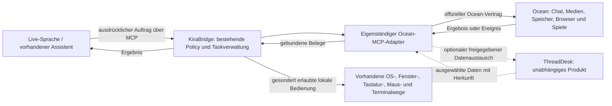

> Historischer Quellenstand aus `21d2e2cad8e9930931b02031addfc25d819a9ed3`,
> bei der Integration am 06.11.2026 bewahrt. Aktueller Quellen-, Prüf- und
> Installationsstand: [RC40-Integrationsnachweis](../RC40-INTEGRATION-INSTALL-20261106.md).
> Datierte Plan- und Gateangaben sind keine neue Auftrags- oder Berechtigungsquelle.

# Ocean-MCP-Adapter: Architektur, Vertrag und Prüfplan

Paket `BIGPLAN-OCEAN-MCP-PLAN-20261105-V1`, Stand 5. November 2026.
Bearbeiter: Codex/root. Grundlage: ausdrücklicher Nutzerauftrag zur **Planung**,
Big-Plan-Skill 1.2.0 und WORKFLOWS 1.0.1. Planbranch
`feat/bigplan-coordination-20261105`, Ausgangspin
`869ff883145a6f07e93ea0e49fa03fc27fd587ba`.

**Status: Planung dokumentiert; öffentliche Quellen geprüft.** Kein Ocean-Adapter
implementiert, registriert oder installiert; keine produktive Anbindung, kein
Ocean-Login, keine Registrierung, Schlüsselanlage, Webhookaktivierung oder
fachliche API-Aktion. Die nachstehenden Tests sind Abnahmekriterien, keine
bestandenen Integrationstests. Bestehende Remote-/Windows-Aufträge bleiben erhalten.

## 1. Ziel und Produktgrenzen

Ocean ist hier Dirks bestehende Alltagsplattform, keine neue KiraBridge-Oberfläche
und kein sechstes intern entwickeltes Verwaltungsprodukt. „WeChat-artig“ beschreibt
die gewünschte Funktionsbreite; eine WeChat-Anbindung ist nicht beauftragt.
Der Ocean-Adapter ist ein eigenes Anwendungsmodul mit eigener Capabilitymatrix,
kein neunter CLI-Adapter und keine Sonderregel im Terminalkern.

ThreadDesk ist **keine Laufzeit-, Konto-, Speicher- oder Freigabepflicht** dieses
Pfads. Ein Ocean-Auftrag muss auch bei nicht installiertem ThreadDesk funktionieren.
Ein späterer Export/Import ausgewählter Inhalte nutzt die vorhandenen TD-Verträge,
benötigt Ziel-/Umfangsbindung und überträgt keine Ocean- oder Rechnerrechte.
Der gesonderte TD-Remote-Auftragsweg des Gesamtplans bleibt davon unberührt.

Live-Sprache bedeutet hier den vorhandenen Assistenten als Auftraggeber. Ocean-
Anrufe und Audionachrichten beweisen keine eigene Live-KI-Sprachverbindung. Es wird
kein neuer Sprachdienst, Modellprovider oder kostenpflichtiger Transkriptionsweg
vorausgesetzt.

## 2. Bestand und aktuelle Primärquellen

Das [Ocean-Impressum](https://ocean.com.de/impressum) ordnet Website, Web-App und
Ocean-Apps ACONI GmbH und Dirk Aldekamp zu. Der bestehende ThreadDesk-Bereich
`30e962aaed81` „Ocean – App und KiraBridge-Anbindung“, Revision 1, enthält eine
historische Beschreibung, aber keine angehängten API-Unterlagen oder Whiteboard-
Befunde. Sein Status `idea` ist kein Implementierungsauftrag.

Am 05.11. wurden öffentliche HTML-Seiten und das darin referenzierte Portal-
JavaScript **nur als Text** gelesen, ohne Ausführung oder Anmeldung. Das Webtool
konnte die Ocean-Seiten nicht öffnen; der öffentliche HTTPS-GET über die vorhandene
CLI funktionierte. Das [Entwicklerangebot](https://ocean.com.de/entwickler) verlinkt
das [Developer-Portal](https://developer.ocean.com.de). Dessen Bundle enthält acht
öffentliche Dokumentationsabschnitte. Diese aktuellen Verträge ergänzen und
überholen die begrenzten Negativaussagen der statischen APK-Recherche vom 03./04.11.

| Quelle | Belegt / sagt aus | Bleibt offen |
|---|---|---|
| [Portalübersicht](https://developer.ocean.com.de/doku/README) | Entwicklerzugang über bestätigtes Ocean-E-Mail-Konto und Mailcode; Entwicklerprofil/Bedingungen, App-ID, einzeln widerrufbare App-Schlüssel, Entwurf/Tester/Prüfung. App-spezifische Pseudonyme, einzeln bestätigte Freigaben. | Zugang für dieses Projekt, zuständiger App-Inhaber, konkret erteilte Rechte und tatsächlich wirksame Widerrufe. Nichts davon wurde angelegt oder akzeptiert. |
| [Bots](https://developer.ocean.com.de/doku/bots) | Eigener gekennzeichneter Bot, App-Schlüssel, Bot-REST-API; Ereignisse per Long-Polling oder signiertem Webhook. Gruppenstandard: Erwähnungen/Befehle; `names` und umfassendes `messages` gesondert. | Eigene Testidentität, tatsächliche ACLs, Retry-/Idempotenzgarantien von Nachrichten und Rechteänderungen im laufenden Betrieb. |
| [Chat-Skills](https://developer.ocean.com.de/doku/skills) | Chat-Kacheln/Karten, eigene Web-/Actionoberfläche, signierter Skill-Ausweis und Server-API. | Keine damit belegte allgemeine API zum Durchsuchen beliebiger Chats oder Galerien. Hosting und tatsächliche freigegebene App fehlen. |
| [Medien-Apps](https://developer.ocean.com.de/doku/medien) | Ausdrücklich ausgewählte einzelne Datei, begrenzter Lese-/Speicherlink, erlaubte Dateiformate; Ersetzen/Version bzw. neues Format. | Allgemeines Albumlisting, Ordner-/Speicherkatalog, revisionsgebundenes Speichern und serverseitiger Konfliktschutz für den Adapter nicht dokumentiert nachgewiesen. |
| [Spiele](https://developer.ocean.com.de/doku/spiele) | Browser/WebView-Spiel auf Entwicklerdomain, Spielausweis; Server-APIs für eigenes Spiel, Ergebnisse, Hinweise und Coins. | Kein allgemeiner Fernsteuerungs- oder Spielzugvertrag für fremde Spiele; kein Beleg einer bestehenden Ocean-MCP-Schnittstelle. |
| [Medien](https://ocean.com.de/medien), [Play](https://ocean.com.de/spiele), [Funktionsübersicht](https://ocean.com.de/funktionen) | Aktuelle Betreiberbeschreibung von Galerie, Cloud/Dateien, externen Speicherzielen und Browser-Spielen. | Produktbeschreibung ersetzt keinen Drittanbieter-API-Vertrag und keine Funktionsabnahme. |
| [Datenschutz](https://ocean.com.de/datenschutz) | Betreiber beschreibt TLS ohne derzeitige Chat-E2EE sowie über URL erreichbare Anhänge. | Kein technischer Nachweis von Backend-/Lösch-/Berechtigungsdurchsetzung. Für Geheimnisse und private Dateilinks als Übertragungsgrenze berücksichtigen. |

Der dokumentierte öffentliche [JWKS-Endpunkt](https://api.ocean.com.de/v1/games/keys)
lieferte beim eigenen GET HTTP 200 und einen öffentlichen Ed25519/EdDSA-Schlüssel.
Das ist ein Metadaten-Lesetest, kein Token-, Login- oder Autorisierungsnachweis.

Historische Recherche, unverändert erhalten:
`~/Desktop/Forschungskoordination-Dirk-2026-11-04/projekte/06-Ocean.md` samt
`inventar/ocean-berichtigungen-und-leseschluessel.md` und
`~/Desktop/Ocean-KiraBridge-Analyse-2026-11-03/team/ocean-protocols.md`.
Sie beschreibt APK `app.ocean.mobile`, SHA256
`df6ae2f04b919b38d6b6b535f677a3c7f70a28903677d9b115f039ee310aa00b`,
private Client-REST-/WSS-Wege und Foto-WebDAV. Die APK wurde diesmal nicht neu
disassembliert. `ocean.session`, anonyme Clientanmeldung und privater Chat-WebSocket
sind **kein Ersatz** für die jetzt dokumentierte externe Bot-API. Vorhandene
WebDAV-Fotofunktionen beweisen keine allgemeine Speichersteuerung über MCP.

Private Abruf-/Herkunftsbelege liegen unter
`~/.local/share/kirabridge/backups/bigplan-ocean-plan-20261105-v1/`:
HTTP-Metadaten, Hashes, HTML, unverändertes Portalbundle und daraus ohne Ausführung
extrahierte Doku. Bundle SHA256
`6be7d98093b04f803a094325034af9215801caa102b472d3c50134c4be4d5d19`;
`portal-doc-extraction.json` bindet acht Texte an ihre Position und ihren Hash.
Originaldokumentation wird nicht vollständig ins Repository kopiert.

## 3. Modulaufteilung und Wiederverwendung

Der geplante Adapter besitzt Ocean-Schemaabbildung, Capabilitybeschreibung,
Protokollvalidierung und Ergebniszuordnung. KiraBridge behält Identität, Policy,
Auftrag/Idempotenz, Locks, Budget-/Stopzustand und Nachweise. Vorhandener MCP-/HTTP-
Unterbau wird verwendet; kein zweiter Dispatcher, keine zweite Queue oder Rechteengine.
Ein isoliert testbarer Modulvertrag und eigener MCP-Namensraum erlauben spätere
separate Paketierung. Ein zusätzlicher öffentlich erreichbarer Server ist dafür
keine Voraussetzung. Transport/SDK-Version werden am konkreten Implementierungspin
festgelegt, nicht durch dieses Dokument installiert.

| KiraBridge-Baustein | Geplante Verwendung und Grenze |
|---|---|
| MCP, Operationskatalog und Policy | Semantische Ocean-Aktionen mit Schema, Effekt, benötigtem Scope und echtem Nachweisgrad; Kontext aus authentifizierter Verbindung, nicht aus Modellparametern. |
| TaskManager, Handoff/Receiver, Idempotenz | Vorhandenen Task und Quittungen referenzieren; Ocean-Ereignis-ID/Cursor ergänzen nur Transportkorrelation, keine zweite Ausführungsverwaltung. |
| Programme/Fenster | Vorhandene `apps.list/inspect`, `windows.list/inspect/focus`, `app.focus` und erlaubte Startwege; App, Prozess und sichtbares Ziel frisch binden. Keine Fenster-ID aus alten Checkpoints übernehmen. |
| Tastatur/Maus/Ansichten | Bestehende Tastatur-, Accessibility-, Capture- und tatsächlich angebotene Mausfähigkeiten wiederverwenden. Mausumfang ist am Planpin nicht als eigenständige allgemeine Operation belegt; pro OS frisch entdecken und prüfen, keine Unterstützung erfinden. |
| Terminal/CLI | Bestehende `session.catalog/read`, `session.input` und `terminal.visible` nur für ausdrücklich beauftragte Rechner-/Agentenaktionen mit eigenen Gates. Ocean-Inhalte werden nicht als Terminalbefehle ausgewertet. |
| OS-Adapter | macOS, Windows und Linux nutzen denselben Ocean-Vertrag. HTTP-Fähigkeit beweist keine GUI-Unterstützung; Headless meldet fehlende Fenster-/Eingaberoute explizit. |

API- und Browserbedienung sind **ausdrücklich ausgewählte Routen** mit getrennten
Belegen. Ein abgelehnter API-/Clientaufruf schaltet nicht auf Maus, Tastatur,
Terminal oder ein anderes Konto um. Die Ocean-App gibt keine lokalen OS-Rechte.
Falls eine benötigte Speicher-API fehlt, wird sie als Vertragslücke geplant;
privater Clientcode oder UI-Automation werden nicht still zum API-Ersatz erklärt.

## 4. Entwurf des Schnittstellenvertrags

Alle folgenden Namen sind **Entwurf**, keine verfügbaren MCP-Tools oder bestätigten
Ocean-Scopes. Der endgültige kleine Werkzeugkatalog wird erst am vorhandenen
KiraBridge-Schema abgeglichen. Jede Fähigkeit meldet `documented`, `verified`,
`unsupported` oder `unknown`, getrennt nach Route, OS und Ocean-Vertragsversion.

| Semantische Fähigkeit | Eingaben / Rechtebindung | Ergebnis / Grenze |
|---|---|---|
| `ocean.describe` | Authentifizierter KB-Kontext, konfigurierte Ocean-App/Route | Protokoll-/Quellpin, Capabilitymatrix, fehlende Grants, ohne Schlüssel oder private Kontodaten. |
| `ocean.chat.read` | Freigegebener eigener Bot-Chat, Cursor, begrenzter Umfang | Nur nach Botvertrag sichtbare Daten; keine Volltextsuche aller privaten Chats. |
| `ocean.chat.send` | Zielbindung, freigegebener Inhaltshash, optionale Antwortreferenz | Vorbereitet, versandt, Ocean-`messageId`, separat zurückgelesen oder Wirkung unklar. |
| `ocean.media.read` / `ocean.media.save` | Ausgewählte Datei, kurzlebige Referenz, Format, Größen-/Revisionsbindung | Dateihash und Zielbeleg; keine breite Speicherberechtigung aus einem Dateilink. |
| `ocean.gallery.list` / `ocean.storage.list` | Künftiger ausdrücklich unterstützter Ocean-Vertrag | Zunächst `unknown/unsupported`; Produkt-UI und private APK-Aufrufe reichen nicht. |
| `ocean.browser.open` | Bestätigte Ocean-/Spiel-URL und eigene sichtbare Browserbindung | Navigation/Ansicht belegt; Spielbeitritt, Einladungsversand und Spielzug sind weitere Wirkungen. |
| Optionale TD-Übergabe | Einzeln ausgewählte Daten, TD-Projekt/Thread, Richtung, Konflikt-/Löschregel | TD-Quittung und Herkunftsreferenz; keine Vollspiegelung, keine zusätzliche Ausführungsfreigabe. |

Gemeinsame Anforderungen an jeden Aktionsauftrag:

- Version, stabile Auftrags-/Idempotenz-ID, Inhalts-/Parameterhash, explizite Route
  und Zielreferenz. Auftraggeber und Gerätebindung stammen aus dem authentifizierten
  KiraBridge-Kontext; Modelle können sie nicht durch gleichnamige JSON-Felder ersetzen.
- Ocean-Bindung aus geprüfter Konfiguration: App-ID, API-Origin, Konto-/Chat-/Datei-
  Pseudonym und freigegebener Umfang. Namen sind Anzeige, keine Identität.
- Bestehende Berechtigungsreferenz samt Ablauf/Widerruf und erlaubtem Effekt;
  Nachprüfung unmittelbar vor einer Wirkung. Lesen, Nachricht senden, Datei ersetzen,
  App starten und Terminalausführung sind verschiedene Aktionen.
- Ergebnis mit Taskreferenz, Ocean-Vertrags-/Adapterpin, Zeit, API-/UI-Route,
  nicht geheimen Ziel-/Ergebnisreferenzen und den tatsächlich beobachteten Stufen.
  Fehler wie `permission_denied`, `identity_changed`, `unsupported_capability`,
  `input_unknown`, `rate_limited` und `outcome_unknown` bleiben unterscheidbar.

Botaufrufe nutzen laut Dokumentation `/v1/bot-api/<app>/…`, Chat-Skills dagegen
`/v1/skill-api/<app>/…`. Bot-Nachrichten liefern eine `messageId`; der öffentliche
Vertrag beschreibt dafür **keinen belegten Idempotenzschlüssel**. Deshalb nach
Timeout/Crash kein blindes erneutes Senden: Zustand aus vorhandenem Taskledger
rekonstruieren und nur über belastbaren Abgleich klären. Fehlt eine geeignete
Readback-/Statusfunktion, bleibt die Wirkung unklar. Lokale Deduplizierung allein
garantiert kein Exactly-once beim externen Server.

Für einen später ausdrücklich aktivierten Bot-Eingang ist ausgehendes Long-Polling
der dokumentierte Weg ohne zusätzlichen öffentlichen Port. Genau ein bestehender
Verbindungslebenszyklus, ein verantwortlicher Consumer und persistenter Cursor;
Offset erst nach dauerhaft gesicherter, verifizierter Übernahme weiterführen.
Ein Webhook ist eine alternative freigegebene Route mit eigener öffentlicher
Bereitstellung, kein automatischer Fallback. Empfangsquittung bedeutet weder
autorisierte Rechneraktion noch Arbeitsbeginn. Ereignisspeicherung und Verarbeitung
müssen Oceans dokumentierte Aufbewahrungs-/Retrygrenzen berücksichtigen.

## 5. Authentifizierung und Sicherheitskonzept

1. **Drei getrennte Ebenen:** Assistent→KiraBridge über vorhandene MCP-/Client-
   Authentifizierung; Adapter→Ocean mit projektspezifischem App-Schlüssel;
   Ocean→Adapter je Vertrag: Bot-Polling als HTTPS-Antwort auf den eigenen
   authentifizierten Aufruf, alternativer Webhook mit eigener HMAC-Signatur oder
   Skill-/Spielaufruf mit überprüftem Ausweis. Pollingantworten sind laut Doku
   keine signierten Ereignisse/JWT. Der Bot-Signaturschlüssel für Webhooks bleibt
   vom App-Bearerschlüssel getrennt.
   Keine Ocean-App-Sitzung aus Browser/Android auslesen, kein Weiterreichen eines
   MCP-Bearertokens an Ocean. Keine Entwickleranmeldung oder Annahme von Bedingungen
   aus diesem Plan ableiten.
2. **Minimaler Ocean-Scope:** Für den ersten eigenen Botraum keine allgemeine
   Gruppenleseberechtigung `messages` und keine Namen `names` voraussetzen. Prüfen,
   was tatsächlich erteilt ist. Raumadmin, Botzugehörigkeit oder Ocean-Pseudonym
   erzeugen keine KiraBridge-, OS-, Vault- oder Kostenrechte. App-/Skill-/Spiel-
   Pseudonyme nicht ungeprüft miteinander oder mit Personen verknüpfen.
3. **Ausweise und Ereignisse:** JWT-Algorithmen explizit erlauben, Signatur,
   `iss`, konkretes `aud`, Ablauf und erforderliche Kontextclaims prüfen. JWKS nur
   aus festgelegter Origin, keine Schlüssel-URL aus fremdem Token übernehmen;
   Rotation begrenzt behandeln. Skill- und Spielausweise haben verschiedene
   Zielgruppen. Bei Webhooks HMAC über unveränderte Bytes, Zeitfenster, sichere
   Signaturprüfung und persistente Ereignisdeduplizierung vor jeder Verarbeitung;
   auch fehlerhafte Header und Längen sicher ablehnen. Ocean-Rechtewiderruf muss
   zusätzlich zur Tokenablaufprüfung wirksam werden; Mechanismus noch zu klären.
4. **Geheimnisse und Dateien:** App-Schlüssel nur im vorhandenen geschützten
   lokalen Credentialweg, nicht in Modellkontext, Board, Git oder Browsercode.
   4AllPass später über seinen geschützten Vertrag, keine neue Pflichtabhängigkeit.
   Medien-/Speicher-/Ausweislinks als Geheimnisse behandeln: auch URL-Fragmente
   aus Logs, Screenshots und TD-Exporten entfernen. Nur festgelegte Origins und
   zulässige Redirects, Schutz gegen SSRF/Privatnetz-/Metadatenzugriff, Pfadwechsel,
   Symlinks, falschen MIME-Typ und unerwartete Dateigröße.
5. **Zweckbindung:** Chat, Bildmetadaten, Dateiname, Kartenaktion und Spielinhalt
   sind fremde Daten, keine Toolanweisung. Kein impliziter OS-/Agentenauftrag und
   kein Vollimport nach ThreadDesk. Vorschau und Empfänger-/Dateiziel vor einer
   freigegebenen Außenwirkung binden. Lösch-/Widerrufsregeln für Adapterdaten und
   optionale TD-Kopien festlegen; nur notwendige nicht geheime Nachweise behalten.
6. **Konflikte und Stopps:** Dateirevision vor Ersetzen prüfen; fehlt bei Ocean
   atomarer Revisionsschutz, Ersetzen nicht als sicher anbieten und geeigneten
   Neu-Datei-/manuellen Konfliktweg vereinbaren. Keine Wiederholung nach unklarer
   Chat-/Speicherwirkung. Bei Identitätswechsel, fehlendem Scope, unbekanntem UI-
   Zustand, Stop, Budgetgrenze oder abgelaufener Bindung Wirkung unterlassen.
7. **Kosten und Spiele:** Bot-Sprachnachrichtentranskription kostet laut Portal
   Coins des App-Inhabers. Nicht Teil des kostenlosen Lesetests oder der
   Live-Sprachroute; ohne gesonderte Freigabe deaktiviert. Auch Uploadquoten,
   Spielbeitritt, Ranglisteneinträge, Coins, Einladungen und fremde Spieler nicht
   durch Demonstrationen verändern. Kein Spielbot-/Anti-Cheat-Bypass.

Für einen späteren HTTP-MCP-Transport gelten der gepinnte
[MCP-Authorization-Vertrag](https://modelcontextprotocol.io/specification/2025-11-25/basic/authorization)
und die [Sicherheitsregeln](https://modelcontextprotocol.io/docs/2025-11-25/tutorials/security/security_best_practices)
zu Audience, Token-Trennung, Proxy-Consent und SSRF. Diese Referenz behauptet
keinen Ocean-OAuth-Server: Ocean dokumentiert hier App-Schlüssel und eigene
Ausweise. Der vorhandene KiraBridge-Transport wird vor einer Erweiterung geprüft.

## 6. Meilensteine und Freigaben

| Etappe | Liefergegenstand / prüfbares Gate | Status und Verantwortung |
|---|---|---|
| OCEAN-00 Quellen/Plan | Offizielle Plattform und Portal zuordnen; öffentliche Verträge, Herkunftsgrenzen, Architektur und Tests sichern. | Dieser Dokumentationsauftrag: Codex; gezielter unabhängiger Planreview. Kein Implementierungsstart. |
| OCEAN-01 Vertragsklärung | Dirk/Kira bestätigen App-Inhaber, freigegebenen Testzugang, Backend-/Dokupin, Scopes, Widerruf, Chat-Readback/Idempotenz und Galerie-/Speichervertrag. Kosten-/Coinfreiheit des ersten Testumfangs festhalten. | Offen. Vorhandenes Portal verwenden; keine Registrierung, Bedingungen, Schlüssel oder Tester ungefragt anlegen. |
| OCEAN-02 Adapterentwurf | Gemeinsamen KB-Auftragsvertrag wiederverwenden; Capability-/Schemaabbildung und Auth-/Negativfixtures definieren; API und UI getrennt. | Entwurf hier; Implementierung und ausführbare Regressionen erst als konkret freigegebenes Paket. Root/Codex entwickelt, unabhängiger Grok-/Peerreview. |
| OCEAN-03 Isolierter Lesetest | Eigener freigegebener Botraum und ausgewählte Datei; fehlender Scope/Widerruf/Replay ohne Wirkung, ThreadDesk abgeschaltet. | Nicht ausgeführt. Keine produktiven Kontakte/Daten oder neuen öffentlichen Dienste. |
| OCEAN-04 Gezielter Schreibtest | Neuer eindeutiger harmloser Inhalt genau einmal im eigenen Raum; eigene Dateikopie lesen/ändern/zurücklesen mit Hash/Revision. Timeout/Crash nicht doppelt ausführen. | Nicht ausgeführt; Außenwirkung braucht konkreten Testauftrag und geeignete Servergarantien. |
| OCEAN-05 Browser/OS | Eigene sichtbare Web-/Spiel-Testansicht, Fokus-/Tabwechsel, vorhandene Tastatur-/Mausroute und sichere Ablehnung eines falschen Ziels. Windows für Dirk, danach passende Mac-/Linux-Capabilities getrennt. | Nicht ausgeführt. Kein Spiele-/Mausneubau aus diesem Plan, keine Verdrängung des Windows-Pakets. |
| OCEAN-06 Echte Live-Abnahme | Aus tatsächlicher Live-Unterhaltung Oceanaktion beauftragen, beobachtete Wirkung und Ergebnis zurückgeben; TD optional getrennt prüfen. | Nutzer/Kira im echten Client. Ersatzclient-/Replaytests separat. Installation, Veröffentlichung und produktive Aktivierung erst nach passender Freigabe. |

Die Planarbeit darf neben bestehenden Paketen stattfinden. Kein Ocean-Paket wird
durch diesen Text als ausführbares `READY` in AutoNext eingetragen. Nach der
Vertragsklärung kann ein begrenztes erstes **lesendes** Implementierungspaket
vorgeschlagen werden; keine acht neuen Baustellen oder ungefragte Dienstlandschaft.

## 7. Testmatrix für das spätere Implementierungspaket

Alle Zeilen sind **geplant / nicht ausgeführt**, außer dem unten getrennt genannten
öffentlichen Metadatenabruf.

| Gruppe | Fälle | Erwarteter Nachweis |
|---|---|---|
| Vertrag/Erweiterbarkeit | Schema-/Versionsabweichung, unbekannte Capability, Mock-Oceantransport, Imports ohne OS-/Netzstart | Isolierter Adapter ohne Ocean-Sonderfälle in Terminal/CLI; Unsupported bleibt explizit. |
| Auth/Rechte | Falsche App/Issuer/Audience/Signatur, abgelaufener/rotierter Schlüssel, fehlender Scope, fremdes Pseudonym/Chat, Widerruf während Auftrag | Keine unzulässige Lese-/Schreibwirkung; keine Rechte aus Namen, Rolle oder Bodyparametern. |
| Bot-Ereignisse | Erwähnung/Befehl, normales Gruppenereignis ohne `messages`, eigene Antwort, andere Bots, doppelte ID, Crash vor/nach Cursor/ACK, Webhook-Replay/Manipulation | Genau eine zulässige Übernahme mit dauerhaftem Taskbezug; ACK ist kein Arbeitsnachweis. |
| Chat | Eigener neuer Text, falsches Ziel, Scopeverlust, 429, Timeout vor/nach Versand, Restart und verlorene Antwort | Versand-/Annahme-/Readbackbelege getrennt; kein zweiter Versand bei unbekannter Wirkung. |
| Medien/Galerie/Speicher | Explizite eigene Datei, falsches Format/Größe/Origin, abgelaufener Link, Redirect/SSRF, fremder Ordner, parallele Änderung, Abbruch | Integrität/Revision erhalten; kein ungeprüftes Überschreiben; allgemeine Galerie bleibt ohne Vertrag unsupported. |
| Browser/Spiele | Korrekte eigene Ansicht, Fenster-/Tab-/Fokuswechsel, falsche App/Prozessidentität, unbekannter Dialog, fehlende Mausfähigkeit, Headless | Keine Eingabe ins falsche Ziel, kein blinder Routenwechsel, keine Coins/Rankings/fremden Spiele verändert. |
| Live-Sprache | Eindeutiger Auftrag, unklarer Empfänger, Zwischen-/wiederholtes Transkript, Clientabbruch, Ergebnisverlust | Nur bestätigte Absicht einmal übernehmen; Verwechslung/Unklarheit stoppen; echter Live-Readback separat. |
| ThreadDesk optional | Nicht installiert/offline, ausdrücklich erlaubter Einzelimport/-export, Konflikt, Widerruf/Löschung, Secret im Link | Ocean unabhängig nutzbar; begrenzter Datenaustausch mit Quittung, keine Rechteeskalation oder Vollspiegelung. |
| Ressourcen | Fehlender Zugang, ausgeschöpfte Quota, Coinpflicht, Stop, Ende der freigegebenen Verbindung | Begrenzter Consumer beendet sich; keine neuen API-Käufe, endlosen Retries oder dauernden Pollingschleifen. |

**Tatsächlich in dieser Runde geprüft:** öffentliche statische Seiten, Portal-
Dokutexte und JWKS-GET. Dokumentlinks, Quellenhashes und Diff werden lokal geprüft.
Keine Ocean-Aktion, keine native Browser-/Spieleprüfung, keine Live-Sprach-,
Windows-, MCP-Integrations- oder produktive End-to-End-Abnahme.

## 8. Übergabe und nächster Einstieg

Quellpin und kurze Checkpoints stehen im Koordinationsboard `482f593429ad`,
Entwicklungsboard `188ce4729a62` und bestehenden Ocean-Bereich `30e962aaed81`;
Einträge werden unabhängig zurückgelesen. Readme DE/EN, Webseiten und Downloads
brauchen für diese interne Planung keine Funktionsankündigung. Bei Umsetzung wird
nur der tatsächlich belegte Ocean-Umfang sachlich ergänzt.

**Nächster Schritt:** OCEAN-01 anhand der vorhandenen offiziellen Portalverträge
mit Dirk/Kira klären: freigegebene Projekt-App/Testidentität, fehlende allgemeine
Galerie-/Speicher-API, Widerrufs-/Konflikt-/Idempotenz- und Readbackgarantien.
Die Plattform-/Portal-URL ist inzwischen gefunden und keine offene Voraussetzung
mehr. Bis zu einem konkreten Folgeauftrag bleibt es bei dieser Planung.
